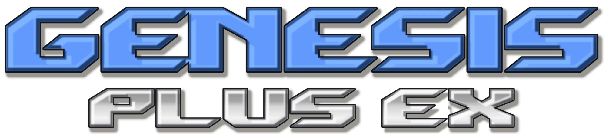
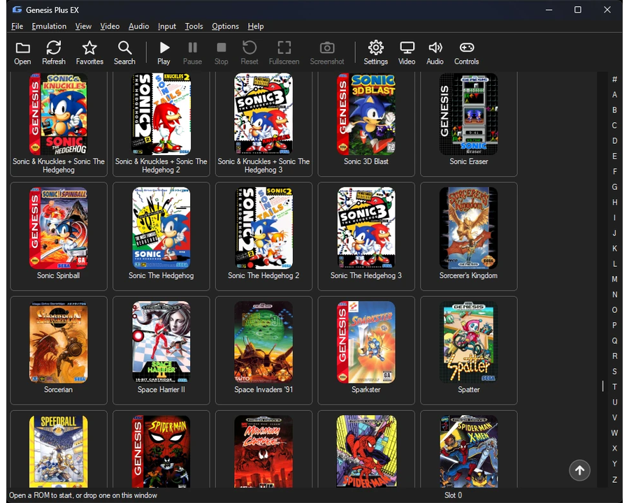
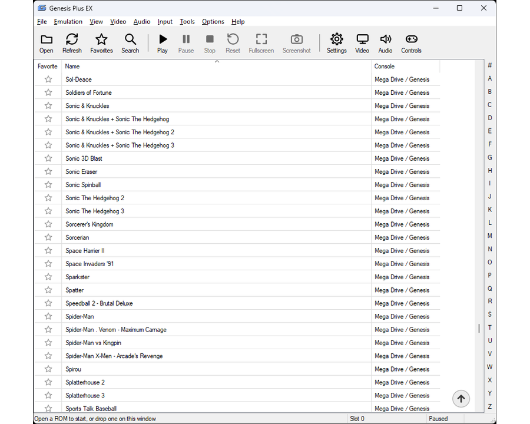
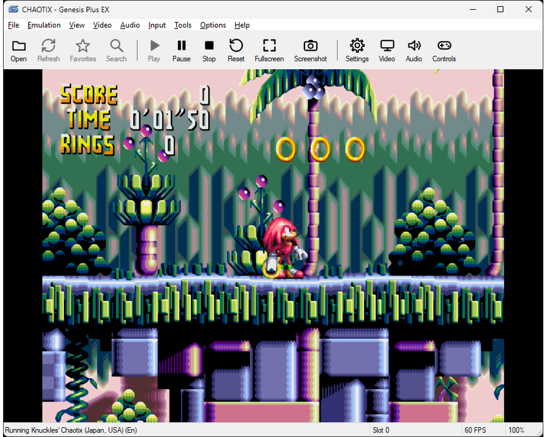
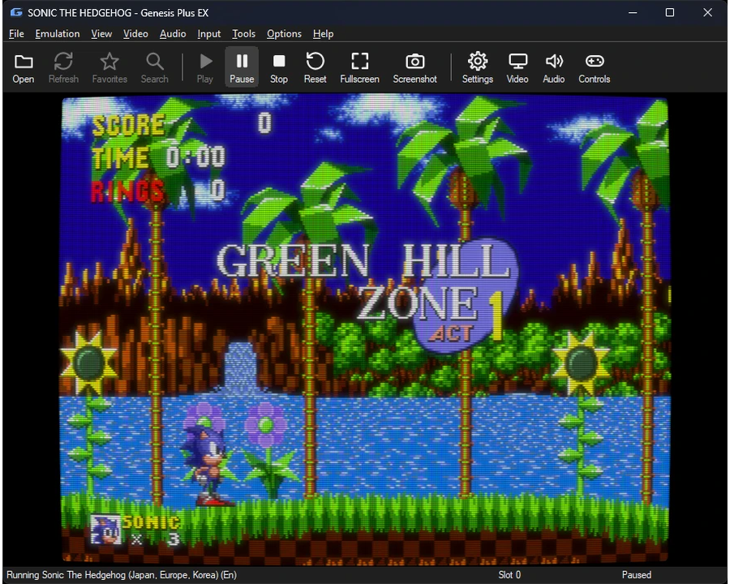
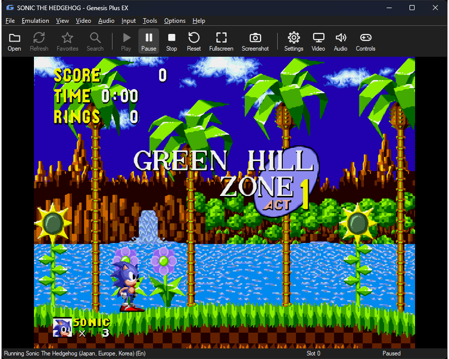
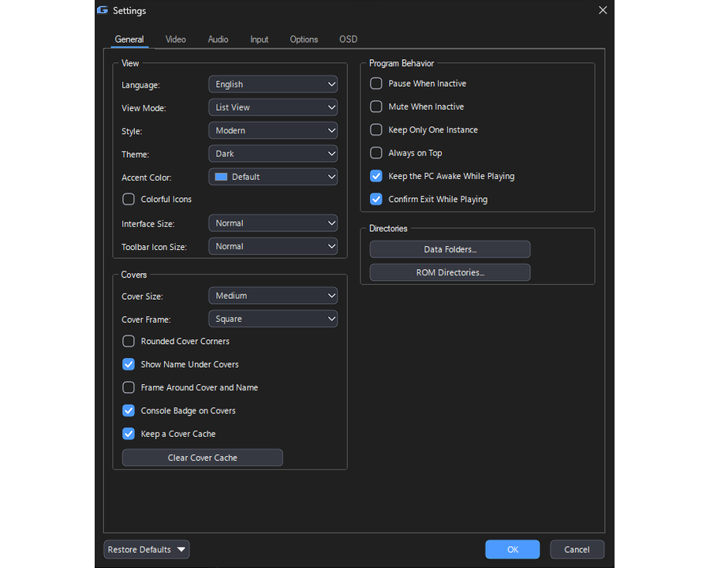
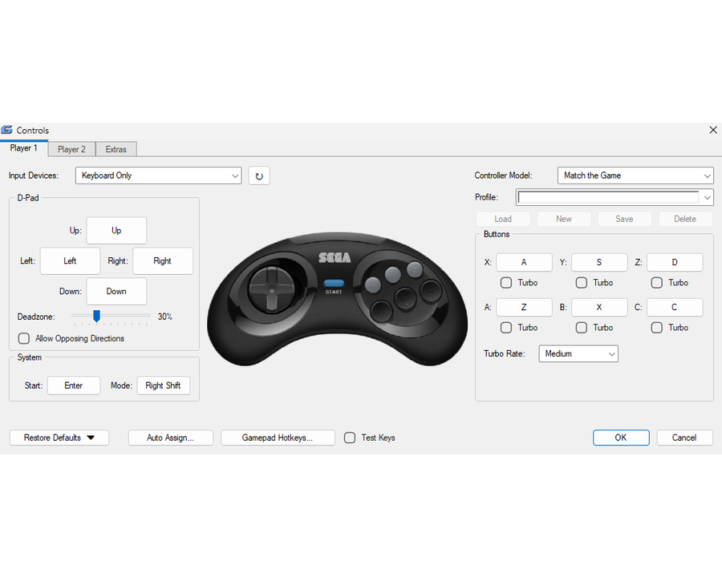

# Genesis Plus EX

**A fast, portable Windows front end for the Genesis Plus GX emulator core and, for 32X games, PicoDrive.**

Genesis Plus EX plays Sega Mega Drive / Genesis, Master System, Game Gear,
SG-1000, Mega CD / Sega CD, Pico and 32X games. It is a native Windows program that
talks straight to the emulator core, with no SDL and no installer: one `.exe`
that uses only DLLs that ship with Windows, and keeps everything it saves in
plain folders next to itself.

It lives in the `win32/` folder of this repository, next to the original `sdl/`
and `gx/` ports, and does not change the core.

By [Hazem Abdelghani](https://github.com/hazem-abdelghani/genesis-plus-ex).
Based on [Genesis Plus GX](https://github.com/ekeeke/genesis-plus-gx) by Eke-Eke (core by Charles MacDonald);
32X games run in [PicoDrive](https://github.com/notaz/picodrive) by Dave, notaz, irixxxx and others. See [License](#license) for the other libraries used.

---
## Contents

1. [Highlights](#highlights)
2. [Screenshots](#screenshots)
3. [Quick Start](#quick-start)
4. [Folders](#folders)
5. [Controls](#controls)
6. [The Game List](#the-game-list)
7. [Saving Your Game](#saving-your-game)
8. [Picture](#picture)
9. [Sound](#sound)
10. [Cheats](#cheats)
11. [Recording and Screenshots](#recording-and-screenshots)
12. [Netplay](#netplay)
13. [32X Games](#32x-games)
14. [MD+/32X+, MSU-MD Games (Enhanced Sound)](#md32x-msu-md-games-enhanced-sound)
15. [Frontends and Command Line](#frontends-and-command-line)
16. [Building from Source](#building-from-source)
17. [Source Layout](#source-layout)
18. [License](#license)

---

## Highlights

| | |
|---|---|
| **Systems** | Mega Drive / Genesis, Master System, Game Gear, SG-1000, Mega CD / Sega CD (multi-disc too), Pico, 32X (through PicoDrive) |
| **Files** | `.zip`, `.gz` and `.7z` open directly; Mega CD from `.cue`, `.chd` or `.bin` (also inside a `.zip` or `.7z`); 32X from `.32x` |
| **Picture** | GDI, Direct3D 9 or Direct3D 11; 40+ built-in render filters in families (xBRZ, real HQx, xBR, LQ2x, ScaleFX, CRT Geom, Super Eagle, 2xSaI, scanlines, aperture grille and more); RetroArch `.slangp` shader presets (Direct3D 11, 64-bit); NTSC filter, scanlines, LCD ghosting, Deinterlacing, integer scaling, bezels; Picture Adjustments (Brightness, Contrast, Saturation, Gamma, Hue) |
| **Sound** | Five FM chip emulations, low-pass filter or 3-band EQ, stereo width, bass boost, WASAPI / XAudio2 / waveOut output |
| **Input** | Keyboard and gamepads (Xbox pads through XInput; PlayStation, Nintendo and other pads through DirectInput), remappable per player; every Sega peripheral (mouse, light guns, Team Player, EA 4-Way Play and more); turbo, combos, profiles |
| **Saving** | 10 save-state slots with thumbnails, rewind, auto resume, rolling backup states, undo for a state load |
| **Library** | List or grid game browser with cover art, search, filters, favorites, recently played, several folders |
| **Cheats** | Game Genie, Action Replay and work RAM byte codes with a Status for each, a Cheat Code Converter, Similar Cheat Files, `.cht` import and export, cheats in netplay, 32X SH-2 memory in Cheat Search |
| **Controls** | Per-player remapping, a Combos list, turbo rate, editable hotkeys (also on the gamepad), controller profiles, Hide Mouse Pointer |
| **Tools** | Debug viewers (memory, VDP, sound, CPU), a CPU Debugger with breakpoints and stepping (68000, Z80 and the 32X SH-2s), RAM Search and RAM Watch (also for the 32X SDRAM), tooltips on every debug control, ROM patching (IPS, BPS), ROM Information, Change Disc, game speed and frame advance, netplay, User Guide |
| **Extras** | Cheats and a cheat finder, input recording, video / audio / GIF / VGM recording, screenshots, LAN netplay |
| **Looks** | Light, Dark and seven colored dark themes (Sapphire, Ruby, Emerald, Amethyst, Amber, Aquamarine, Diamond) with tinted buttons, menus, title bar and scroll bars; accent colors, a Classic or Modern style, Large interface |
| **Languages** | Translations are plain `.po` files in a `Languages` folder (Options > Language); only English ships, `Template.pot` is the template |
| **Portable** | No installation; copy the folder to a USB stick and it keeps working |

---

## Screenshots

| | |
|---|---|
|  |  |
| Grid view with cover art (dark theme, Modern style) | Game list (light theme) |
|  |  |
| A 32X game (Knuckles' Chaotix, run by PicoDrive) | CRT look |
|  |  |
| Mega Bezel shader with a bezel | xBRZ filter + Bilinear |
|  |  |
| Settings (Modern style, dark theme) | Controls window |

---

## Quick Start

1. Put `Genesis Plus EX.exe` in a folder of its own and run it. It creates its
   data folders next to itself on first start.
2. Open a game in any of these ways:
   - **File → Open ROM** (Ctrl+O),
   - drag a game onto the window,
   - **File → ROM Directory** (Ctrl+R) to browse a folder of games,
   - pass the game on the command line.
3. Play. The keyboard works at once (see [Controls](#controls)); a connected
   gamepad needs no setup either.

Both a 64-bit (`Genesis Plus EX.exe`) and a 32-bit (`Genesis Plus EX-32bit.exe`)
build exist. The 32-bit one has no shaders, because the shader library has
no 32-bit version.

Most settings are in **Options → Settings...** (tabs: General, Video, Audio,
Picture, Input, Options, OSD). Hover over any option for a short description.
**Help → User Guide** inside the program explains every menu item and the Settings, Controls, Cheats and Netplay windows.

Windows 10 version 1903 or later is recommended: it lets game and folder names
use any language. Older Windows still works with its own code page.

---

## Folders

Everything is relative to the program, so the folder can be moved or copied.

If the program's own folder cannot be written to (for example in `Program Files`), the program keeps these folders and files in `%LOCALAPPDATA%\Genesis Plus EX` instead (**File → Open Genesis Plus EX Folder** opens the one in use). `BIOS`, `Languages`, `Plugins`, `Shaders` and `Bezels` are still read from beside the program first; put a BIOS in the `BIOS` folder of whichever place you like.

```
Genesis Plus EX.exe
Plugins/               the DLLs the program loads when needed: librashader.dll (shaders) and
                       picodrive_libretro-64.dll / -32.dll (the 32X emulator, PicoDrive)
genesis-plus-ex.ini    all settings
ROMs/                  a place for your games, with a folder per console made at the first start (MegaDrive, MasterSystem ...; add it under ROM Directories; any other folder works just as well)
BIOS/                  optional BIOS and add-on ROMs
Saves/                 battery saves (.srm) and Mega CD backup RAM (.brm; MegaCD/cart.brm is the Mega CD's 512 KB RAM cartridge, extra save space)
States/                save states
Screenshots/           PNG screenshots, one folder per console
Cheats/                cheat lists (.cht), one folder per console (the console folders of ROMs, Cheats and Images/Covers are made at the first start, to put files in;
                       `Other`, for a game that is no known console, is made when needed)
Images/                pictures: Covers/ (cover art, one folder per console, matched to games by file name), Bezels/ (bezel images)
                       and Pico-Storyware/ (the pages of Sega Pico books: a folder per game).
Recordings/            Video, Audio, GIF, VGM and Input recordings (a folder each, and in it a folder per console)
Languages/             translations (Name.po), see Languages below
Profiles/              controller profiles
Shaders/               shader presets you pick (created on first use)
Logs/                  genesis-plus-ex.log (with Enable Log), the crash report and dump (with Enable Crash Report)
                       (Settings → Options → Troubleshooting → **Factory Reset...** deletes the settings file (both the one beside the program and the one in `%LOCALAPPDATA%\Genesis Plus EX`, when each exists) and starts the program again as a new copy)
```

**Settings → General → Data Folders...** moves any of these folders (everything but Plugins and Logs) somewhere else: a list of the folders and their paths, with **Change...** and **Use Default**. Empty means beside the program; files already in the old place are not moved.

Saves, states and covers are grouped per console and per game:

```
Saves/MegaDrive/Sonic The Hedgehog/Sonic The Hedgehog.srm
states/MasterSystem/Alex Kidd/Alex Kidd.gp0
covers/MegaDrive/Sonic The Hedgehog.png
```

The console folders are `MegaDrive`, `MasterSystem`, `GameGear`, `SG1000`, `MegaCD` and
`32X` (and `Pico` for Sega Pico games, found by their header, also inside zip and 7z archives). **File → Open Genesis Plus EX Folder** opens the program folder.

### BIOS and Add-on ROMs (Optional)

Put these in `BIOS/`. Cartridge games run without any of them. Mega CD games
need the BIOS for their region.

| File | Used for |
|---|---|
| `bios_CD_U.bin`, `bios_CD_E.bin`, `bios_CD_J.bin` | Mega CD, by region (**required** for Mega CD) |
| `bios_MD.bin` | Mega Drive start-up (TMSS) ROM |
| `bios_U.sms`, `bios_E.sms`, `bios_J.sms`, `bios.gg` | Master System / Game Gear start-up ROMs |
| `ggenie.bin`, `areplay.bin` | Game Genie, Action Replay |
| `sk.bin`, `sk2chip.bin` | Sonic & Knuckles lock-on |
| `32X_G_BIOS.BIN`, `32X_M_BIOS.BIN`, `32X_S_BIOS.BIN` | 32X BIOS (Genesis, Master SH-2, Slave SH-2): **not needed and not used**; PicoDrive starts 32X games without them |

Turn the start-up ROMs on with **Settings → Options → Boot from BIOS When
Available**.

A Mega CD game without its BIOS does not start: the message names the file it needs
(by the game's region) and the BIOS folder it belongs in.

---

## Controls

### Keyboard Defaults (Player 1)

| Key | Mega Drive pad |
|---|---|
| Arrow keys | D-pad |
| Z, X, C | A, B, C |
| A, S, D | X, Y, Z |
| Enter | Start |
| Right Shift | Mode |

### Gamepad Defaults (XInput)

The left stick and D-pad move. X, A and B give A, B and C; Y gives X; RB gives
Y; RT gives Z; Start is Start and Back is Mode. LB fast-forwards and LT rewinds.
The right stick is a set of four extra buttons that can be assigned like any
other, and by default it does the save-state shortcuts.

### Other Pads (DirectInput)

Pads that Windows does not show as an Xbox pad are read through DirectInput:
PlayStation pads (DualShock 4, DualSense), Nintendo pads (Switch Pro Controller
and its kin, Switch Online pads) and other joysticks. Pick one in
**Input → Controls... → Input Devices** and its buttons start in a layout that fits
it: the D-pad (or left stick) moves, the three buttons at the Mega Drive pad's
A, B and C spots give A, B and C, the top button gives X, R1 / R (or RB) gives Y,
R2 / ZR gives Z, and Options / + is Start and Share / − is Mode. Everything can be
changed in the same window. A Joy-Con is a joystick of its own, so one is used
at a time (held sideways). The log (**Settings → Options → Enable Log**) lists each
pad with its vendor and product ids.

### Changing the Controls

**Input → Controls...** has a tab for Player 1, Player 2 and an Extras tab.

- Click a button, then press the key or gamepad button you want. The same
  press works for keyboard and pad; there is no separate mode. **Esc** or a
  right click cancels. **Auto Assign** goes through all the buttons in turn.
- A key or button can only be on one pad button; assigning it takes it from
  the old one and a line under the pad says so.
- **Turbo** is a box beside A, B, C, X, Y and Z; **Turbo Rate** sets how fast: Slower (7.5 presses a second), Slow (10), Medium (15, the default), Fast (22.5) or Faster (30).
- **Deadzone** sets how far a stick must move before it counts.
- **Allow Opposing Directions** (Player 1 and Player 2 tabs, below the D-pad buttons) lets Left and Right, or Up and Down, be held together. A real pad cannot do it, so only one of the two reaches the game unless this is ticked (a few games and glitch tricks need both).
- **Stick Directions** (Settings → Input): how the left stick makes the D-pad's diagonals. *Classic* compares each direction with the deadzone on its own (a small push off a straight line already adds a second direction); the other choices use the angle of the push, the deadzone being only how far it has to go: *Wide Straight Zones* (a drifting stick keeps running straight: Sonic does not roll), *Even Eight Directions* and *Wide Diagonal Zones*.
- **Crosshair Shape, Color and Size** (Settings → Input → Light Gun): the look of the light gun crosshair (the list draws each shape beside its name; the Windows cross, or one of eight shapes drawn by the program (plus, plus with a gap, dot, circle with a dot, circle with ticks, crosshair target, diamond, diamond with a dot); white, red, green, yellow, cyan or black, with an outline of the opposite brightness; four sizes).
- **Controller Model** and the **Extras** tab choose what is plugged into
  each port: Control Pad, Mouse, Light Phaser, Menacer, Justifier, XE-1AP,
  Activator, Paddle Control, Sports Pad, Graphic Board (Pico), Team Player,
  EA 4-Way Play, Master Tap or Smash Controller.
- **Sega Pico:** the games' voices play (the program makes the console's speech chip, which the Genesis Plus GX core leaves out), and save states keep the voice that is playing. The controls are these (Input → Controls changes the D-pad and the red button, Input → Hotkeys the page keys):

  | | Keyboard and mouse | Xbox pad | PlayStation / Switch / other pad |
  |---|---|---|---|
  | D-pad | Arrow keys | D-pad or left stick | D-pad or left stick |
  | Red button | Z, X or C; right mouse button | A, B or X | The same places (Cross / Circle / Square, B / A / Y) |
  | Pen | Mouse (left button touches) | Right stick moves it; RT, a press of the stick or Start touches | Right stick moves it; R2 / ZR, R3 or Start touches |
  | Previous / next page | Page Down / Page Up | LB / RB | L1 / R1 (L / R) |

  Over the game the mouse pointer is always hidden, because the game draws the pen itself (a hammer, a brush); Hide Mouse Pointer applies to the other games. The gamepad hotkeys on the right stick, Fast Forward and Rewind do not run in a Sega Pico game.

  **Storyware window.** Page Up / Page Down turn the page of the storybook (up to page 7) and open this window, which also opens when the game starts. It is as big as the picture of the open page, and the mouse over it is the pen on the book's page, as on the real console, so what is printed in the book can be clicked. Put the pictures in `Images/Pico-Storyware/<game>/`, a folder named like the game's file, each picture named like the game with the page number after it: `<game>_1.png`, `<game>_2.png` ... (`_0` is the closed book; PNG, JPG or BMP). They are your own scans; none comes with the program.
- **Profiles** (Load / New / Save / Delete) keep whole control setups, both
  players, pad types and combos, in the `Profiles` folder.
- **Gamepad Hotkeys...** puts shortcuts on pad buttons: fast forward, rewind,
  turbo, states and slots, pause, reset, screenshot, fullscreen, mute, the frame rate,
  recording, game speed and an in-game pause menu. An optional hold button
  keeps the pad free for the game until it is held.
- **Input → Enable Background Input** keeps pad input working while another
  window has focus.

### Controller Layouts (pads read through DirectInput)

A pad that is not an Xbox-style one starts with a layout that fits it: first by its maker (Sony and Nintendo pads), then by what the program's
copy of SDL's game controller database says about that pad (looked up by its USB vendor and product id, about 860 pads). The face buttons, shoulders,
triggers, Start and Back of the pad are laid out like a Control Pad: A, B and C on the bottom row, X on the top row, the right shoulder as Y, the
right trigger as Z, Back as Mode. A trigger that is an analog axis is used as a button too (see below). A pad the database does not know keeps the
maker's layout, and buttons you set yourself are never replaced. The vendor and product id of a pad are in the log (Settings > Options >
Enable Log): "Controller: ... (vendor 054C, product 0268)". The database is [SDL_GameControllerDB](https://github.com/mdqinc/SDL_GameControllerDB)
(zlib license, Copyright (C) 1997-2025 Sam Lantinga and the contributors of the database); `win32/tools/make_controllerdb.py` makes `controllerdb.bin`
from its `gamecontrollerdb.txt`.

`controllerdb.bin` is not SDL's file itself but a small copy made from it: only the Windows entries (866 pads), each reduced to the pad's USB vendor
and product id and the ten buttons the program uses (a, b, x, y, back, start, the shoulders and the triggers), then compressed. It is about 6 KB, against
about 610 KB for `gamecontrollerdb.txt`, and it is built into the program (a resource, like `genres.bin`), so nothing has to be shipped beside the exe.
`gamecontrollerdb.txt` is not part of this source. To bring the list up to date, download a newer `gamecontrollerdb.txt` from the project above, run
`python3 tools/make_controllerdb.py gamecontrollerdb.txt` in the `win32` folder (it rewrites `controllerdb.bin`) and build again.

On a pad read through DirectInput, the analog axes that are not the right stick (the triggers of many pads) can be assigned like buttons: click a button in Controls and pull the trigger; it shows as `Axis Z+`, `Axis RX-` and so on. A trigger counts as pressed when it is pushed more than half way from where it rested when the pad was first read.

### Combo Buttons

On the Extras tab, one key or pad button can press several game buttons.
Pick a row, choose the **Trigger**, then click the game buttons to add. **Hold**
keeps a button down for a time (0.25 to 10 seconds) or until you press it
yourself, and **Pause** waits before the next one, so `Gamepad Y → Down (Hold
1.0 s) + A` is a Sonic spin dash on one button. Up to 12 combos; **How It
Works** in the window has an example.

### Keyboard Shortcuts

Every shortcut can be changed in **Input → Hotkeys...**. The defaults:

| Shortcut | Action |
|---|---|
| Ctrl+O / Ctrl+R | Open a ROM / ROM Directory |
| F2 (or Pause) / F3 | Pause / Stop |
| F4 / Ctrl+F4 | Reset / hard reset |
| F5 / F8 | Save / load the selected state slot |
| 0 – 9 / Shift+0 – 9 | Load / save that slot directly |
| F6 / F7 | Previous / next slot |
| Ctrl+F5 / Ctrl+F8 | Undo the last save / load |
| Tab (hold) | Fast forward |
| Backspace (hold) | Rewind |
| Ctrl++ / Ctrl+- / Ctrl+0 | Game speed faster / slower / normal (25 – 400 %) |
| `\` or `Tab` | Advance one frame while paused |
| Page Down / Page Up | Sega Pico: previous / next page of the book (opens the Storyware window) |
| Alt+Enter, Esc | Fullscreen |
| Ctrl+M / Ctrl+N / Ctrl+B / Ctrl+D / Ctrl+P | Mute all / FM / PSG / DAC (drums and voices) / PWM (32X games) |
| Ctrl+T | Show / hide the frame rate |
| Ctrl+C | Cheats |
| Ctrl+F | Search the game list |
| Ctrl+H | Hide / show all the bars (menu bar, toolbar and status bar) while a game runs, in a window or fullscreen (View → Toolbars → Hide All Bars) |
| F12 | Screenshot |
| Shift+F11 / Ctrl+F11 / Ctrl+F12 / Alt+F11 | Record video / audio / GIF / stop |
| Shift+F10 | Record a VGM file |
| F1 | List of shortcuts |

---

## The Game List

**File → ROM Directory** (Ctrl+R) shows your games. Double-click one to play,
or right-click for more: play with a saved state, edit its cheats, cover image,
favorite, remove from recently played, create a desktop shortcut, open its ROM location, saves, states and cheats folders. Right-click on empty
space shows the same menu with the choices for a game grayed. With more than one ROM
folder set, *Open ROM Directory* opens a list of them.

- **List or grid.** **View → View Mode**. The grid shows cover art; its size
  runs from Tiny to Extra Large (Ctrl + mouse wheel sets any size) and the
  shape, rounded corners, captions and a card frame are in Settings → General.
  *Console Badge on Covers* (on by default; switch it off in Settings → General) puts a small coloured tag in the corner of each cover to tell
  the consoles apart: MD, MCD, 32X, SMS, GG, SG or PICO.
  *Region Flags* (on by default; Settings → General) draws a small flag for each region of a game, taken from the tags of the file name such as `(USA)`
  or `(Japan, Europe)`: in the Region column of the list instead of the region text (a game without a region tag gets a flag with a question mark),
  and in the bottom left corner of each cover in the grid view. The pictures are in the `images/flags` folder of the source (USA, Europe, Japan, World, Korea,
  Brazil, Australia, Canada, China, Hong Kong, Russia, Taiwan, Unknown) and are built into the program. The countries of Europe (Germany, France,
  Spain, Italy, Sweden, Netherlands, UK) show the flag of Europe, Asia the World flag; for those the column also writes the name after the flag, so the
  country can still be told. `python3 tools/check_po.py --selftest` checks the rules of the translation check. Switch the option off to see the region text again.
  Covers are cached so they appear at once the next time (*Keep a Cover Cache*), and the console of each
  game file is kept too (`Images/Covers/library.dat`), so a big library loads faster after the first start. The Refresh button forgets it and looks at every file again.
- **Search and filters.** Type in the search bar (Ctrl+F). Search words narrow
  by one field: `region:usa`, `console:mega cd`, `genre:action`, `type:chd`,
  `fav:yes`. The filter bar narrows by console, genre and region.
- **Several folders.** **Settings → General → ROM Directories...** adds more
  folders, removes any of them, and excludes folders from the scan. Subfolders
  are scanned too.
- **Window.** **View → Always on Top** (also in Settings → General) keeps the window above all others, and *Reset Window Size* puts it back at the
  size set under Video.
- **Tidy names.** *Clean Game Names* hides tags like `(USA, Europe) [!]`, in the
  list and in File → Recent Files.
- **Recently played, favorites, groups.** A *Recently Played* group at the top (those games are in the full list too; the filter bar does not hide them there),
  stars for favorites (and *Show Favorites Only*), *Group by Console*, an A–Z
  strip (pressing a letter again goes to the next console's games with it), and sortable columns (Genre, Region, File Size, File Type and more).
- **Typing** a letter jumps to the game that starts with it.
- **Dropping files.** A game opens, a `.cht` file is imported and a `.gpstate`
  file loads into the running game.

**Multi-disc Mega CD games** (such as *Lunar: Eternal Blue*) ask for the next
disc themselves, as on a real console; pick the file and the game carries on
with no reset. **File → Change Disc...** does it by hand.

**File → Run Mega CD BIOS** (USA, Europe or Japan) starts the Mega CD's own BIOS with no disc, to reach its CD player and
settings screen. It needs the BIOS file of that region in the `BIOS` folder (`bios_CD_U.bin`, `bios_CD_E.bin` or `bios_CD_J.bin`); it is not added to the recent files or the played list.

---

## Saving Your Game

- **Save states.** Ten slots, each with a thumbnail and the time it was saved.
  **Manage States...** shows them all; right-click a slot (also an empty one) to save to it, copy it
  to a file (*Save This Slot As...*) or delete it; double-click an empty slot to save to it. States can also be saved to
  and loaded from any `.gpstate` file to share them.
- **Undo.** *Undo Load State* and *Undo Save State* go back one step.
- **Rewind.** Hold Backspace to run recent play backwards. A bar shows how much
  history is left. History size is 128 to 768 MB (256 MB by default); Rewind Speed is Slow, Normal (the default), Fast or Very Fast. While the game is paused, each press of the rewind key goes back one frame (held longer, frame after frame), the way the frame advance key goes on.
- **Auto Resume** (on by default). The game is saved when you close it and you
  are asked whether to carry on next time. The exit question has a
  *Resume this game next time* box.
- **Backup State.** Optionally saves quietly every 1 to 10 minutes into three
  rolling backups (**Emulation → Load State → Load Backup State**).
- **Skip intro.** Optionally runs the first few seconds (of game time) of a game at full speed, which takes much less real time.
- **Battery saves** are written automatically as `.srm` / `.brm` files.

---

## Picture

### Renderer, Size and Shape

- **Video → Renderer:** GDI (CPU), Direct3D 9 or Direct3D 11. Each falls back
  to GDI by itself when it is not available.
- **Window Size** 1× to 10× (3× by default; a window you drag to a size keeps it for the next game until you pick a size again; **Lock Window Shape When Resizing** in Settings → Video, on by default, can be switched off to drag the window to any shape), fullscreen as a borderless window or
  exclusive with its own resolution, hide the mouse pointer after
  a few seconds.
- **Light Gun Border:** a white frame (2, 4, 6 or 8% of the window's height) round a smaller picture while a light gun is plugged in, for guns that find the screen with a camera (the Sinden Lightgun). Off by default (Settings → Input). A shot with the pointer on the bars or the frame is a shot off the screen (reload in Lethal Enforcers and others).
- **Aspect Ratio:** *Original Console Pixels* (the default, the Mega Drive's own
  pixel shape), 1:1, 4:3 or 16:9. **Integer Scaling** keeps every pixel the same
  size. **Scaling Filter** (Nearest, Sharp Nearest, Bilinear, Sharp Bilinear or Bicubic; Sharp Nearest first enlarges the picture by a whole multiple with sharp pixels, then smooths only the rest of the way; Sharp Bilinear is Bilinear with a narrow blend (about half a source pixel, on a smooth curve), so much less blur; Sharp Bilinear and Bicubic are pixel shaders with Direct3D 9 and 11; the classic renderer does Sharp Bilinear on the processor and has no Bicubic, which is grayed there; the whole filter is grayed while a Direct3D 11 shader runs, because the shader scales the picture itself), border color, overscan borders and interlaced mode
  (single or double field) are all options. In a game that draws a 448-line picture (Sonic 2's two player mode) *Single Field* shows the same
  half of it every frame, so it stays steady; *Double Field* shows all 448 lines: where something moves, the older field's lines are rebuilt from the new ones (which stay exactly as the game drew them), so there are hardly any comb teeth and a moving object stays sharp (a pattern that repeats and scrolls, such as blades of grass, is found too).
- **Picture adjustments:** Brightness, Contrast, Saturation, Gamma and Hue (sliders in **Video → Picture Adjustments...**, with *Restore Defaults* and *Cancel*) and Brighten; **Video → Visual Effects → Deinterlacing** for a game in the 448-line interlaced mode (Sonic the Hedgehog 2 in 2P Vs. mode, Ys III, Air Strike Patrol): the graphics processor draws both fields from the same moment in every frame, so every frame is a whole picture and nothing that moves is combed (on by default; Interlaced Mode is not used while it is on);
- **Video menu choices that stay open:** Render Filter, Visual Effects, Scanlines, NTSC Filter, Aspect Ratio, Rotation and Borders keep the menu open after a click, like the View menu's choices, so several can be tried in a row; it closes when you click outside it or press Esc.
  **Flicker Blending** (makes games that flash an object every other frame to
  fake transparency look solid); **Dither Smoothing**; a **Bezel Image**
  drawn around the picture in fullscreen.
- **Effects:** the Blargg **NTSC filter** (composite, S-Video or RGB),
  **Scanlines** (25 – 100 %), **LCD Ghosting**, **Color Correction** (Off, Light, Full: every console gets the paler, duller, slightly blended colors of a handheld LCD screen (as on the Game Gear) instead of the raw ones; Hue, Saturation and the other Picture Adjustments still apply on top).

### Render Filters

**Video → Render Filter** applies a pixel filter before the picture is scaled
to the window. They are built into the program.

| Filter | Result |
|---|---|
| Scale2x, Scale3x, Scale4x | Smooths diagonals of pixel art and keeps the rest (Scale4x is Scale2x run twice) |
| MMPX 2x, MMPX Enhanced 2x | MMPX (Morgan McGuire and Mara Gagiu): a pixel-art magnifier that keeps lines and shapes clean without adding colors; Enhanced (by CrashGG) also blends dithering and soft edges. Enhanced is built with the xBRZ filters, so a build with `XBRZ=0` has only MMPX |
| ScaleFX 3x | Sp00kyFox's ScaleFX: follows edges up to level 6 with smooth changes of slope, and only uses colors that were in the picture (ported from its shader; a little heavier on the processor) |
| Eagle 2x / Eagle 4x | Classic Eagle rules; can thin single-pixel lines (4x is the 2x run twice) |
| 2xSaI / 4xSaI | The classic "Scale and Interpolate" look: smooth, slightly soft diagonals (4x is the 2x run twice) |
| Super Eagle / Super Eagle 4x | A smoother Eagle: keeps diagonals going and blends the corners |
| Super 2xSaI / Super 4xSaI | A softer 2xSaI: more blending along lines |
| Smooth 2x / 4x | Edge-directed corner smoothing; crisp and cheap |
| HQ2x / HQ3x / HQ4x | The real hqx by Maxim Stepin: smooth corners that keep the pixel art's shapes |
| LQ2x | A lighter, faster cousin of hq2x |
| xBR 2x / 3x / 4x | Hyllian's xBR: smooth diagonals and curves, sharp edges (a close relative of xBRZ) |
| **xBRZ 2× to 6×** | The real xBRZ: smooth curves and clean thin lines; slightly softer |
| Scanlines 2x / 3x / 4x | Rows dimmed (3x and 4x have a bright middle and dimmer edges, like a beam) |
| Glow Scanlines 3x | Scanlines where bright pixels keep their beam and bleed a little sideways |
| CRT 3x (RGB Mask) | Red / green / blue phosphor stripes plus scanlines |
| CRT Aperture Grille 3x | Trinitron-style stripes with hardly dimmed rows |
| CRT Geom 3x | The classic CRT-Geom: curved glass with rounded corners, beams that widen with brightness, a dot mask and the CRT's gamma (ported from its shader; **very heavy**, it uses up to four processor threads) |
| CRT Shadow Mask 3x | Staggered phosphor dots with darker rows between them |
| LCD Grid 2x - 6x | The pixel grid of a handheld screen (use *LCD Ghosting* in Video > Visual Effects for the ghosting) |

The 5x and 6x sizes (and xBRZ) are in the normal build; they make a large picture, so they ask a lot of the
processor.

The **Render Filter** menu lists the filters sorted by name, with each family (CRT, HQ, LCD Grid, Scale,
Scanlines, Smooth, xBR, xBRZ) in a sub-menu of its own. The resizing methods (Nearest, Sharp Nearest, Bilinear, Sharp Bilinear, Bicubic) are in **Scaling Filter**, which scales the picture to the window after the render filter.

A render filter and the NTSC filter cannot be on together. xBRZ keeps a 64 MB
table while it is selected (about 80 – 100 MB extra) and frees it when you
switch away.

### Shaders

**Video → Shaders → Preset...** loads a RetroArch-style
`.slangp` preset (CRT looks, phosphor masks, upscalers) through
[librashader](https://github.com/SnowflakePowered/librashader). It needs the
**Direct3D 11** renderer and the **64-bit** program, and `librashader.dll` must
be in the `Plugins` folder next to the `.exe` (it is included; next to the `.exe` also works). **Shader Parameters...** adjusts the
preset's own settings while it runs.

### Looks of the Program

- **Theme** (View > Theme, or Settings > General): *System* (follows Windows), *Light*, *Dark*, or one of seven colored dark themes
  **Sapphire** (blue), **Ruby** (red), **Emerald** (green), **Amethyst** (purple),
  **Amber** (yellow), **Aquamarine** (cyan) and **Diamond** (silver). A colored theme tints the grays of the dark theme toward its color
  and brings its own default accent color: the background, text boxes, lists, menus (drawn by the program), toolbar, title bar
  (Windows 11), buttons and drop-downs (flat and rounded, also in the Classic style) and the back-to-top button all follow it, and
  the lists, list boxes and multi-line text boxes get scroll bars of the theme's color (laid over the system's, which stay
  underneath). Windows draws the scroll bars inside open drop-down lists itself, so those stay gray.
  Choosing a theme puts the accent color back to Default. The Style and Theme choices in the View menu keep it open, like the other
  View choices, so several can be tried in a row; it closes when you click outside it.
- **Style:** *Classic*, or *Modern* with flat rounded buttons, check boxes,
  drop-downs and tabs, softer toolbar buttons,
  rounded window corners and a themed title bar (Windows 11), and Segoe UI text.
- **Accent Color:** *Default* (the color of the theme: blue in the Dark theme, Windows' own in the Light one), Blue, Brown, Crimson, Gold, Gray, Green, Indigo, Lime, Magenta, Navy, Olive, Orange, Pink, Purple, Red, Sky Blue, Teal, Violet or Yellow, for
  selections, tabs and list headings.
- **Colorful Icons:** the icons of the menus, the toolbar and the favorite star in color, one color for each kind of
  action (off by default: black and white, in the color of the text).
- **High Contrast Mode** (off by default): while Windows is in a high-contrast mode the program uses the Light theme and the Classic style, so the windows take the colors Windows chose; your own theme and style come back when high contrast is turned off.
- **Interface Size:** Normal or Large (the program restarts to change it).
- **On-screen messages (Settings → OSD):** position, size, color, time (1 – 7
  seconds), how many show at once (1 – 7), and a frame-rate counter.

### Languages

The text of the program is English. **Options → Language** lists the languages found in the `Languages` folder
(a menu, a window, a message, a tooltip and the User Guide are shown in the chosen one); changing it asks to restart the program. A language is a UTF-8 text file `Name.po` (the gettext format, which Poedit and other editors
open); `Name` is the file name; the menu shows the `Language-Name` of the file's header (for example `Français`), written in the language itself and never translated.

To make one, copy `Languages/Template.pot` to `Languages/Name.po` and fill in the `msgstr` of the texts to translate.
A text without a translation stays English, so a language can be made a little at a time. Keep the `&` (the underlined
key of a menu item), the `%s`, `%d`, `%X` (they are replaced by values, in the same order) and the line ends `\n`
and `\r\n`. The program does not use a translation whose `%` markers differ from the English text (it would read a value as another kind and could
crash or show garbage): that text stays English, and a line in the log tells how many. `python3 tools/check_po.py Languages/Name.po` (run in the `win32` folder) lists them,
with warnings for line ends, tabs and `&` keys that differ. New text in the source needs no marking: the program looks every text up in the language file. `make -f Makefile.win32 pot` (it runs
`tools/make_pot.py`) makes `Template.pot` again from the source, so the new text appears in it; translators then add the new lines to their
`.po` files. It finds text written as quoted strings in the `.c` files and the menus and dialogs of `gpex.rc`; a sentence put together from
pieces at run time is translated piece by piece.
A translation is often longer than the English: a button, check box, label or drop-down that is too narrow for its text is made wider where there is room (a dialog grows if it must), and a label that still does not fit ends in "...".
Only English ships with the program; `Template.pot` is the template for community translations.
Options → Language (and Settings → General → Language) lists **System** first, then English: the program then uses the `.po` file of the `Languages` folder that is for the language of Windows (its header says `Language: fr`, or the file is named `fr.po`, `fr_CA.po` ...), and English when there is none. For a language written from right to left (Arabic, Persian, Hebrew) put `Language-Direction: rtl` in the header: the windows, dialogs, message boxes, menus (the menu bar and the pop-up menus), toolbar, search bar and status bar are then mirrored and read from the right. The picture of the game and the game list are not flipped (the light gun reads the pointer from the picture, and the covers must keep their side), and the debugger, memory viewer, RAM search and RAM watch stay left to right, as code and numbers are in any language; the text in them still reads from the right.
To translate, [Poedit](https://poedit.net) (free) is the easiest way: choose *File > New from POT/PO file...*, pick `Languages/Template.pot`, choose the language, and save the result as `Languages/Name.po`; set `Language-Name` in the header (Catalog > Properties > Custom headers) to the name the language gives itself, which is what the Options > Language menu shows.
To see how the windows cope with long translations without knowing a language, run `python3 tools/make_pseudo.py` in the `win32` folder: it makes `Languages/Pseudo.po` (every text about 40% longer, accented, between `[` and `]`; a missing `]` means that control crops). Pick Pseudo in Options > Language. It is a test file, not part of the release.

---

## Sound

- **Output:** Windows Classic (waveOut), XAudio2, WASAPI shared (the default) or
  WASAPI exclusive, at 22050, 44100 or 48000 Hz, with a choice of sound device.
- **FM chip:** YM2612 or YM3438, either the cycle-accurate Nuked versions (YM2612
  Nuked is the default) or MAME (Discrete, ASIC or Enhanced). **High-Quality FM**
  is on by default. The Master System FM unit can be Auto, Off or On, with its
  own chip choice.
- **Tone:** a **low-pass filter** (adjustable strength) or a **3-band EQ**; only
  one at a time. **Console Model** presets set up a Model 1 or Model 2 sound.
  Also **Stereo Width**, **Headphone Crossfeed** (Light, Medium or Strong: a little of each ear's sound, with the highs taken off, goes into the other ear), **Bass Boost**, **Overdrive**, **Even Out Loudness**,
  mono output and high-quality PSG resampling.
- **Levels and Latency...:** master, FM, PSG, CD audio, Mega CD PCM and DAC volume,
  buffer size, and a live level meter.
- **Mute** all sound, FM only (Ctrl+N), PSG only (Ctrl+B) or the DAC (drums and voices, Ctrl+D) only; *Mute When
  Inactive* silences the game when another window has focus. *Pause When Inactive* pauses it instead.
- Changing the FM chip or unit during a game can leave some instruments quiet
  until the game sets them again or you reset. These choices are locked during
  netplay.

---

## Cheats

**Tools → Cheats...** (Ctrl+C) keeps a list of codes for the game, saved in
`Cheats/<Console>/<game>.cht` and loaded again the next time. Tick a code to
turn it on or off at once, no reset needed. The same list opens, without
starting the game, from its right-click menu or from this menu item with the
game picked in the list.

| Console | Code types |
|---|---|
| Mega Drive / Genesis / Sega Pico | Game Genie (`ABCD-EFGH`), raw patch (`aaaaaa:dddd`), work RAM byte (`aaaaaa:dd`, for example `FFB030:FF`) |
| Mega CD / Sega CD | The Mega Drive codes, which act on work RAM (`FF0000` and up), the first 512 KB (`000000` to `07FFFF`) and Word RAM (`200000` to `23FFFF`) |
| Master System / Game Gear / SG-1000 | Game Genie (`ABC-DEF`, or with a reference byte), Action Replay (`00XX-YYYY`), raw RAM (`aaaa:dd`) |
| 32X | The Mega Drive codes above for the Mega Drive half (cartridge ROM and the 68000's work RAM), and `06AAAAAA:DD` (a byte) or `06AAAAAA:DDDD` (a word) for the SH-2 processors' shared 256 KB memory (see the 32X section) |

- **Enable Cheats** is off until you turn it on.
- **Status column:** Active, Off (not ticked), Cheats are off, Game not running, or Code not valid for this system
  (the code is not one this console understands). Click #, Code, Description or Status to sort the list (the # is the number a cheat got when it was added; it stays with the cheat). Right-click the column titles for Size All Columns to Fit; click again
  to turn the order round.
- **Similar Cheat Files** lists other cheat files of the game's console folder that start like the game's name; choosing one loads its cheats, or, when the list already has cheats, offers Load (replace the list) or Insert (merge the file's cheats into it).
- **ROM codes after a start:** they wait for the first button press after a game starts or is reset, at least two seconds and twenty at most (a game checks its ROM first).
- **Netplay:** both PCs need the same cheats switched on before connecting; the list is compared.
- **Convert...** lists a code as Game Genie, Action Replay or raw, one form to a row.
- **Export...** saves the list as a RetroArch `.cht` file, to keep, share or use in another program (Load Cheat reads it back).
- **Shared codes:** a `.cht` file named after a game's CRC32 (for example
  `A1B2C3D4.cht`) in `Cheats/library` is used by any game with no list of its own.
- **Cheat Search...** finds where a value (lives, health, ammo, a score) is kept
  in memory, so you can make a cheat without a code: *First Scan*, change the value in the game, pick a comparison and *Next Scan*, and repeat until a few
  addresses are left. The Memory choice (work RAM, Mega CD memory, 32X SDRAM) is remembered for the same game while the program runs, and so is the
  scan itself when the window is closed (until the game stops).
**Tools > Fix Checksum...** saves a copy of the open Mega Drive / Genesis game with the checksum of its header (at $18E) made right: the sum of the words from $200 to the ROM End the header states. For hacks, translations and patched games, and for flash carts that check it. The open game is not changed. When the ROM End in the header is not the end of the game, it asks whether to set that right too. ROM Info shows the header's checksum, the sum of the whole file and the sum of the header's own range.

All the debug tools open in **one window, the Debugger** (**Tools > Debugger...**): the CPU Debugger on top (for a game with a 68000) and, on tabs under it, the Memory Viewer, VDP Viewer, Sound Viewer, CPU Viewer, RAM Search and RAM Watch. The **View** button at its top left shows a part directly: Memory, any view of the VDP (Registers, Palette, Tiles, Sprites, Plane A, Plane B, Window, Sprite Layer, Sprite Preview, H Scroll, V Scroll), of the Sound Viewer and of the CPU Viewer, RAM Search and RAM Watch. Drag the bar under the CPU Debugger to resize it; Esc closes the window. The Debugger has its own button on the taskbar, so it can be minimized to it. Every control of the debug windows has a tooltip: hold the pointer over it.
Credit: the debug tools are a port of **gpgx_debugger** by Vladimir Kononovich ([lab313ru](https://github.com/lab313ru)).

- **Memory** (a tab of the Debugger) shows the memory of the running game in hex, in a window of its own that stays open: 68000 RAM, Z80 RAM, VRAM,
  CRAM, VSRAM and the ROM (a Mega CD game also its PRG-RAM and Word RAM, a 32X game its SDRAM and the video memories). Pick the memory at the top, type an address and press Enter (or Go)
  to jump to it, and scroll with the wheel, the arrow keys, Page Up / Page Down, Home and End. Bytes that changed a moment ago are shown in red. Click a byte and type
  hex digits to change it: any of the memories (the registers of the 68000, the Z80 and the video chip are memories too; the 68000's and the video chip's can be changed) can be changed (VRAM, CRAM and VSRAM the way the video chip would write them, so the picture follows; the ROM until the game is closed), except during netplay. CRAM is shown in the form the game writes it (BBB0GGG0RRR0). For a 32X game this needs the `picodrive_libretro` plugins of the same version as the program.
- **VDP**, **Sound** and **CPU** (tabs of the Debugger) are windows of the same kind for what the chips hold now, updated while the game runs. The VDP Viewer shows the
  video chip's Registers (click a register and **Edit Register...**, or double-click: a window with its bits to tick, and a hex value, that sets the register like a game does), the Palette (point at a color for its value, double-click to change it with the color picker), the Tiles (with a choice of palette line, and of VRAM or the 68000's RAM as the source, a zoomed copy of the tile pointed at in the strip), the Sprites (in the order the chip draws them, or the order of the table),
  Plane A, Plane B and the Window as pictures (Zoom 1x to 8x, Ctrl + wheel zooms, a drag with the middle button pans; point at a tile of a plane for its details, click to lock one), the **Sprite Layer** (every sprite where it is, with the screen framed), a **Sprite Preview** (one sprite large, with its palette line) and
  **H Scroll** and **V Scroll**, which plot the scroll of every line and column of both planes, so a raster effect (water, parallax, wobble) is seen as a curve. The Sound Viewer shows the FM chip's channels (key state, frequency, algorithm and each operator's settings; the YM2413 as registers) the PSG's tones, volumes and noise, and for a 32X game the PWM chip (its control and cycle registers, the sample rate, the last samples and the FIFO fill). The CPU
  Viewer shows the 68000 and Z80 registers. These views are read only, and the VDP Viewer is for Mega Drive games. They work with 32X games too (PicoDrive's video chip, sound chips, 68000, Z80 and both SH-2 processors; the CPU Viewer has a Master SH-2 and a Slave SH-2 view), which needs the `picodrive_libretro` plugins of the same version as the program.
- **Buttons and menus of the debug windows:** the VDP Viewer has **Dump Pal** / **Load Pal** (the 64 colors as a 128-byte `.bin`, in the form the game writes them), **YY-CHR Pal** (a `.pal` file for the YY-CHR tile editor) and **Gray & Rainbow** (lines 0 to 2 of the palette become an ascending gray, a descending gray and a rainbow) in its Palette view,
  **Dump VRAM** / **Load VRAM** (65536 bytes) in its Tiles view, and **Dump** (the sprite list as text) in its Sprites view. In the Memory Viewer you can select several bytes (drag, or Shift with a click or an arrow key), and right-click for **Copy**, **Copy Numbers**, **Copy Characters**,
  **Copy Address**, **Paste**, **Paste to Numbers**, **Paste to Characters**, **Dump to File...** (the selection, or the whole memory when one byte is selected) and **Go To...**.
- **RAM Search** (a tab of the Debugger) narrows down the addresses of the game's RAM (the 68000's, or the Z80's) by what their values do (a 32X game also its SDRAM, at 6000000), the way the RAM Search of Gens does: pick the size (1, 2 or 4 bytes, with *Misaligned values* to allow odd addresses), the type (signed, unsigned or hex), what to compare with (the **previous value**, a **specific value**, a **specific address** or the **number of changes**) and how (less, greater, or the same, equal, not equal, **different by** N, **modulo** N), and press **Search** again and again as the game changes. **Reset** starts over, **Undo** takes back the last step, **Eliminate** drops the picked results, **Clear Change Counts** zeroes the counts, **Autosearch** searches at every moment, and **Add Watch** sends the picked results to the RAM Watch.
  Tools > Cheat Search is the simpler search that makes a cheat.
- **RAM Watch** (a tab of the Debugger) is a list of addresses whose values are shown while the game runs, with a note for each: the value is red for a moment when it changes. **New...**, **Edit...** (also a double-click), **Remove**, **Duplicate**, **Separator**, **Move Up** and **Move Down**
  work on the list; in the New and Edit window you can also type a value to put into that address. **New List**, **Open...**, **Save...** and **Append...** use the `.wch` files of Gens. A list is kept in a file only when you save it (**Save...**, which asks where); **Open...** brings it back.
  Addresses are those of the 68000 (RAM at E00000 to FFFFFF, Z80 RAM at A00000, the ROM from 0; for a 32X game also the SDRAM at 6000000), or of the Z80 for the 8-bit consoles (RAM at C000 to FFFF).
- The **CPU Debugger** (the top of the Debugger window) stops the 68000 of the game (in a 32X game also its Master and Slave SH-2): **Break** stops it at the next instruction; **Continue** (F5) lets it go on; **Step Into** (F7), **Step Over** (F8, a call is run as one step), **Step Out** (until the current call returns) and **Run to Cursor** (F4) go on from there. The window shows the instructions around the one it stopped at, disassembled (scroll with the wheel, or type an address and **Go**),
  the registers, and the calls that led there. Double-click a line (or select it and press F9) to set an **execute breakpoint** there (a red dot); **Add...** makes one that stops the game when an address, or a range, is **read** or **written** too. While the game is stopped the other debug windows keep showing it as it is, and the main window waits. In a 32X game pick the processor (68000, Master SH-2 or Slave SH-2) next to **Go**; the window follows the one that stopped, and each has its own registers and calls, SH-2 instructions are disassembled by PicoDrive's disassembler, and only **execute** breakpoints exist (they need the Plugins of the same version as the program). Otherwise it works on the main 68000 only: not the Z80 (the core cannot stop it), and in a Mega CD game a read or write breakpoint may also catch the second 68000. It is off during netplay. The program is built with the core's CPU hook for it, which costs a very little speed.

---

## Recording and Screenshots

| Action | Where | Shortcut |
|---|---|---|
| Video + Audio | `Recordings/Video/<Console>/` (`.mp4`, H.264 + AAC) | Shift+F11 |
| Audio only | `Recordings/Audio/<Console>/` (`.wav`) | Ctrl+F11 |
| Animated GIF (up to 6 s, picture only) | `Recordings/GIF/<Console>/` | Ctrl+F12 |
| VGM sound log | `Recordings/VGM/<Console>/` (`.vgm`) | Shift+F10 |
| Input recording (`.gpm`; stopped with Tools → Record → Stop Input Recording / Playback, not by Alt+F11) | `Recordings/Input/<Console>/` | Tools → Record → Record Input |
| Stop a video, audio, GIF or VGM recording | | Alt+F11 |
| Screenshot | `Screenshots/<Console>/` (`.png`) | F12 |

Files are named after the game and the time. **Settings → Options → Screenshot
Output** chooses what a screenshot contains: *Corrected* (the default:
the picture stretched to the 4:3 shape of a TV, 640×480), *Raw* (the console's own picture at its
own size, not stretched) or *Final* (like Corrected, with the render filter applied). **Screenshot Size** makes it 1×, 2×, 3× or 4× that size (Raw is enlarged in whole pixels, so it stays sharp). Scanlines and Brighten are never included.

**Settings → Options → Video Recording** sets the size (1×–4× the console's own picture; 2× by default), the quality (automatic or 4–32 Mbit/s) and the shape (the console's own, 4:3 or 16:9) of a video recording.

**Tools → Record → Record Input...** saves a state and every button you press afterwards
to a `.gpm` file (named after the game and the time, like the other recordings); *Play Input Recording...* replays it exactly. Use the same
game. Handy for speedruns and bug reports.

---

## Netplay

Two people on the same network can play together (**Tools → Netplay...**).
It is lockstep without rollback, so it suits a LAN best.

1. Both load the **same ROM**, use the **same `.exe`** and the same settings.
2. The host picks a port (default 55455), an input delay (1 – 4 frames) and
   optionally a session code, then presses **Host**.
3. The guest presses **Find hosts**, chooses the host (or types its address),
   enters the code and presses **Join**.

The host is Player 1 and the guest Player 2; each uses their own Player 1
controls. Both games reset and start together. The status bar shows the ping.

- Only cartridge games work (not Mega CD), and both ports need a Control Pad.
- Pause, reset, states, cheats, rewind, fast forward and emulation settings are
  locked during a session. Cheats work: both PCs must have the same cheats switched on before connecting (Cheats is one of the settings compared; the cheat dialog is locked during a session).
- A setting that differs between the PCs refuses the connection and names it.
  The games are compared every second; if they drift apart the session ends.
- If the link drops, both sides wait up to a minute and carry on from the same
  frame.
- *Open the Port on My Router Automatically (UPnP)* (off by default) lets friends
  outside your network join with your public address. Otherwise forward the
  port yourself. Windows Firewall may ask to allow TCP 55455 and UDP 55456.
- The session code only prevents joining the wrong machine; nothing is encrypted.

---

## 32X Games

Sega 32X games (`.32x` files, or a `.bin`, `.zip` or `.7z` that has the "SEGA 32X" header) run on
[PicoDrive](https://github.com/notaz/picodrive), because Genesis Plus GX has no 32X. PicoDrive is built as a
small library, `picodrive_libretro.dll`, that sits in the `Plugins` folder next to the program (it is included; next to the program also works). The program loads it
only when a 32X game is opened. The picture, the sound, the controls, the save states and the recording are
the program's own, so the render filters, shaders, scaling, screenshots, volume and the rest work as they
do for other games.

- **Controls:** six-button pads on both ports, with the keys and buttons you have set up (turbo and combos too).
- **Saves:** states, backup states, Auto Resume and battery saves work, in a `32X` folder of their own
  (`Saves/32X/...`, `States/32X/...`). A state of a 32X game does not load into another console's game.
- **Speed:** the 32X has two extra SH-2 processors. The library runs them with a plain interpreter, which
  keeps it simple and safe but needs a reasonably fast PC.
- **Cheats:** Game Genie, Action Replay and raw codes (`AAAAAA:DDDD`) work for the Mega Drive half of a 32X game: its cartridge ROM
  and the 68000's 64 KB work RAM. The SH-2 processors' memory (the 256 KB SDRAM the two 32X processors share) can be
  patched too, with a code `06AAAAAA:DD` for a byte or `06AAAAAA:DDDD` for a word (`AAAAAA` is the address, 0 to 3FFFF within that
  memory); Cheat Search has a *32X SDRAM (SH-2)* choice under Memory to find such addresses. The cheats are kept in the `32X`
  folder under `Cheats`.
- **Rewind:** works too (it keeps PicoDrive's own states, about 680 KB each, so the same Rewind History Size holds fewer seconds of play than for
  a Mega Drive game, and the 32X needs a bit more of the PC for it).
- **Also work:** input recording and playback (the recording starts from a state of the game), the Region setting (the library
  changes its region, and with it 50 or 60 Hz, at once), the Low-Pass Filter (the library's own, with the same range), Mute FM,
  Mute PSG (the PWM sound of the 32X has its own **Mute PWM Sound** in Audio > Mute, and a **PWM Preamp** slider in Levels and Latency; **Mute DAC Sound** and **DAC Volume** do not reach 32X games) and LCD Ghosting.
- **VGM recording:** logs the FM chip, the PSG and the 32X PWM to a `.vgm` file (format 1.71), starting with the state the chips are in, so a
  recording that begins while a song plays still has its instruments (also after a state was loaded: the FM chip is read back, for a Mega Drive game with either kind of FM chip and for a 32X game); the end of the file releases every held note and turns the PSG down. Most of a 32X game's music is PWM, which only some players can
  play (libvgm-based ones); the FM and PSG parts play anywhere.
- **Netplay:** works between two PCs with the same game file and program version. Both start the game again from power-on (the library is
  loaded afresh and the start-up frames run with no button pressed) and compare a fingerprint of the whole machine once a second. It needs
  PicoDrive to run exactly the same on both PCs; if it does not, the session ends with a message. Mute FM and Mute PSG are off during netplay.
- **Also for 32X games:** FM Chip (PicoDrive has two chip types, YM2612 and YM3438, so the YM3438 kinds play as a YM3438 and the others as a YM2612),
  the Console Model presets, High-Quality FM Synthesis (switches PicoDrive's FM filtering), the 3-Band EQ, the Sample Rate and the FM and PSG levels of Levels and Latency (the CD audio and PCM levels are for Sega CD games and are grayed out).
- **Not for 32X games:** the settings that belong to the Genesis Plus GX core: the Master System FM unit and chip,
  and the controller types other than the six-button pad (mouse, light gun, multi-tap; the port and controller model drop-downs in Controls are
  grayed out too). These are grayed out in the menus and in Settings while a 32X game runs. High-Quality PSG, Borders, Interlaced Mode, Console and Force VDP Mode stay available (they are kept for the other games; Force VDP Mode also sets the 32X game to NTSC or PAL). The **NTSC Filter** works for 32X games too, as the
  program's own version of the look (Composite blurs brightness and color, S-Video only the color, RGB a little); the picture keeps its size.

The 64-bit program needs the 64-bit PicoDrive library and the 32-bit program the 32-bit one. They are named
`picodrive_libretro-64.dll` and `picodrive_libretro-32.dll`, so both can stay in the `Plugins` folder.


---

## MD+/32X+, MSU-MD Games (Enhanced Sound)

MD+/32X+ and MSU-MD games are cartridge games (for the Mega Drive, and for the 32X) patched so that their music plays from audio files, the way a Mega SD or Mega CD add-on plays CD audio.

**MD+/32X+ games.** A game comes as the ROM and a `.cue` sheet with the same name in the same folder (for example `Golden Axe.md` and `Golden Axe.cue`), plus the audio tracks
the sheet lists (`.wav` or `.ogg`). The sheet has MegaSD lines such as `REM LOOP` or `REM NOLOOP`.

- **Mega Drive games:** open the ROM, not the `.cue`. The MegaSD overlay turns itself on when such a sheet is found, so there is nothing to set. The game list shows the ROM only: an MD+
  `.cue` beside its ROM is left out, so it does not appear as a Mega CD game; the same goes for the sheet of an MSU-MD game (audio tracks only).
- **32X games:** open the ROM as usual. When a `.cue` of that name is beside it, the program starts the game from the sheet, which is how PicoDrive wants it (the ROM is found by PicoDrive itself).
  A 32X game with music runs its sound at 44100 Hz, the rate of its tracks, whatever **Settings → Audio → Sample Rate** says (the other rates are grayed out while it runs): at 48000 Hz the music crackled. The game list shows the ROM only.

**MSU-MD games.** MSU-MD patches (for Mega Drive games, and for 32X games) play their music from the tracks of a disc image. The game comes as the ROM, a `.cue` sheet with the same name and the audio track file or files the sheet names (for example one `.bin` holding all the tracks), all in the same folder; the name in the `FILE` line of the sheet has to be the real name of the file. They need the Mega CD BIOS for the game's region in the `BIOS` folder (`bios_CD_U.bin`, `bios_CD_E.bin` or `bios_CD_J.bin`). Open the ROM, not the `.cue`. A sheet that lists audio tracks only (no data track) belongs to a game with music, it is not taken for a Mega CD disc. If the sheet names a file that is missing, the program says which one when the game starts.

**In a `.zip` or `.7z`.** A game that needs files beside it can be kept in an archive: an MD+ or MSU-MD game (the ROM, its `.cue` and the audio files; one ROM and one `.cue`
in the same folder of the archive are taken as a game) and a Mega CD disc (a `.cue` with its `.bin` and audio tracks, or a `.chd` or `.iso`). The archive
is unpacked whole into a temporary folder when the game starts, which takes a while for a disc (the status bar counts the files) and needs room for it on the drive that holds the temporary folder; the folder is removed when the game is closed (and one a crash left behind, at the next start). A 32-bit program may
not have the memory for a large disc in a `.7z`. The game list shows a Mega CD disc in an archive as Mega CD. (Based on the core's MegaSD support and on PicoDrive; not tested with every game.)

---

## Frontends and Command Line

The game is the last argument. Options go in front (a leading `-` or `--`).

| Option | Effect |
|---|---|
| `-f`, `--fullscreen` | Start in fullscreen (for this launch only) |
| `-w`, `--windowed` | Start in a window |
| `-x`, `--exit-on-close` | Quit when the game stops, so the launcher gets control back |
| `-s N`, `--state N` | Load save-state slot N (0 – 9) once the game has started |
| `--state-file FILE` | Load a state file |
| `-m`, `--mute` | Start muted |
| `-p`, `--paused` | Start paused |
| `--scale N` | Window size, 1 to 10 times the picture |
| `--config FILE` | Use another settings file (the folders of saves, states and covers stay where they are) |
| `--profile NAME` | Use a controls profile from the Profiles folder (it replaces the saved controls) |
| `-h`, `--help` | List the options |

```
"Genesis Plus EX.exe" --fullscreen --exit-on-close "C:\Roms\Sonic The Hedgehog (USA, Europe).zip"
```

For a multi-disc Mega CD game give the first disc's `.cue` or `.chd`.

32X games (`.32x`, or a `.bin`, `.zip` or `.7z` with the "SEGA 32X" header) are started the same way; the PicoDrive files in `Plugins` have to stay beside the program.

| Launcher | Setup |
|---|---|
| LaunchBox | Add the program as an emulator, put `--fullscreen --exit-on-close` in the default command-line parameters |
| Pegasus | `launch: "C:\Emulators\Genesis Plus EX.exe" --fullscreen --exit-on-close "{file.path}"` |
| Playnite | Arguments `--fullscreen --exit-on-close "{ImagePath}"` |
| ES-DE, EmulationStation, RetroBat | `"C:\Emulators\Genesis Plus EX.exe" --fullscreen --exit-on-close %ROM%` |
| Steam ROM Manager and others | Anything that runs `"Genesis Plus EX.exe" [options] "<rom>"` |

**Settings → General → Keep Only One Instance** makes a second start (or a
double-clicked game file) open the game in the copy that is already running.

---

## Building from Source

You need MinGW-w64 (with `g++`), zlib and `make`. Nothing else. The same source
builds a 32-bit or a 64-bit program: **the compiler you use decides which one**.

### On Windows (MSYS2)

1. Install [MSYS2](https://www.msys2.org/) with the defaults.
2. Open the shell of the size you want from the Start Menu (not the plain
   "MSYS2" shortcut): **MSYS2 MINGW64** for the 64-bit program, **MSYS2 MINGW32**
   for the 32-bit one. Each shell has only its own compiler on the path.
3. First time only: `pacman -Syu` (reopen the window if it asks you to).
4. Install the tools in that shell (do it once in each shell you use):
   ```sh
   pacman -S mingw-w64-x86_64-gcc mingw-w64-x86_64-zlib make     # in MINGW64
   pacman -S mingw-w64-i686-gcc   mingw-w64-i686-zlib   make     # in MINGW32
   ```
5. Go to the `win32` folder (drives appear as `/c`, `/d`, ...) and build:
   ```sh
   cd /c/path/to/genesis-plus-gx/win32
   make -f Makefile.win32 -j4
   ```

What you get (the name and the folders follow the compiler, so the two sizes never share files):

| Shell | Program | Object files | 32X library |
|---|---|---|---|
| MINGW64 | `Genesis Plus EX.exe` | `build_win32_64/` | `Plugins/picodrive_libretro-64.dll` |
| MINGW32 | `Genesis Plus EX-32bit.exe` | `build_win32_32/` | `Plugins/picodrive_libretro-32.dll` |

Both can be built one after the other with no cleaning in between, and both programs
can sit in the same folder. The program loads the 32X library of its own size.

**If the 32-bit build fails after a 64-bit one** (or the other way round), you are
building with an older copy of the makefile, or you set `OBJDIR` to the same folder
for both. `make` decides what to rebuild only by the dates of the files; it does not
know that an object file was made by a 64-bit compiler, so it keeps the 64-bit object
files and tries to link them into the 32-bit program (or the reverse), which fails.
The fix is a folder per size (the makefile now does that by itself), or
`make -f Makefile.win32 clean` before changing the size.

### Cross-Compiling on Linux

```sh
sudo apt install mingw-w64 libz-mingw-w64-dev make
cd win32
make -f Makefile.win32 CROSS=x86_64-w64-mingw32- -j4      # 64-bit
make -f Makefile.win32 CROSS=i686-w64-mingw32-   -j4      # 32-bit
```

The names and folders are the same as in the table above.

To choose them yourself, give each size its own folder and name (never share an `OBJDIR`
between a 32-bit and a 64-bit build):

```sh
make -f Makefile.win32 CROSS=x86_64-w64-mingw32- OBJDIR=./out64 NAME="Genesis Plus EX.exe"
make -f Makefile.win32 CROSS=i686-w64-mingw32-   OBJDIR=./out32 NAME="Genesis Plus EX-32bit.exe"
```

### Cleaning

`make -f Makefile.win32 clean` removes the object folder of the size you build (give it the
same `CROSS=` you built with), the program and its 32X library.

### Options

| Option | Effect |
|---|---|
| `DEBUG=1` | Keep symbols, no optimization |
| `CHD=0` | No `.chd` and `.7z` support (skips libchdr and its lzma / zstd code) |
| `OGG=0` | No OGG CD audio (skips the bundled Tremor decoder) |
| `PICO=0` | Does not build `picodrive_libretro.dll` (the 32X emulator); the program then cannot run 32X games |
| `PICODRC=1` | Builds the PicoDrive SH-2 dynamic recompiler too (faster 32X, but not tested on Windows) |
| `PICONAME=name.dll` | Gives the library another file name (the default is `picodrive_libretro-64.dll` or `-32.dll`, for the size you build) |
| `NAME=file.exe`, `OBJDIR=folder` | The program's file name and the folder of the object files (the defaults depend on the size, see above) |

`CHD` and `OGG` are on by default and build from sources in the repository.
Turning them off roughly halves the build time if you only play cartridges.

Headers in angle brackets, such as `<windows.h>` or `<d3d11.h>`, come with the
MinGW-w64 compiler; only headers in quotes are files of this project.

---

## Source Layout

Everything for this front end is in `win32/`. The files `fileio.c`, `unzip.c`
and `error.c` are reused from `../sdl`, and the include path puts `win32/` first
so the core sees this port's `osd.h`.

| File | Role |
|---|---|
| `main.c` | Window, menus, game start and stop, the emulation loop |
| `video.c`, `d3d9_video.c`, `d3d11_video.c` | Picture: scaling, renderers, fullscreen, on-screen text, screenshots |
| `filters.c`, `xbrz_glue.cpp`, `xbrz/`, `xbr/` | Built-in render filters, including xBRZ, xBR and HQx |
| `shader_chain.c`, `librashader/` | Shader presets through `librashader.dll` |
| `audio.c`, `audio_be.c` | Sound output and the sound backends |
| `input.c`, `hotkeys.c` | Keyboard, XInput, pointer devices, combos, shortcuts |
| `browser.c`, `coverart.c`, `history.c` | Game list, grid and covers, play history |
| `cheats.c`, `patches.c` | Cheats and ROM patches |
| `dialogs.c`, `settings.c`, `theme.c`, `toolbar.c` | Windows, the Settings dialog, themes and styles, toolbar |
| `recorder.c`, `movie.c`, `vgm.c` | Recording video, audio and GIF; input recording; VGM logs |
| `netplay.c`, `upnp.c` | Network play and router port opening |
| `picobook.c`, `picopcm.c` | Sega Pico: the Storyware window (the page picture and the pen pad); the speech chip (the voices), put on to the core from outside |
| `paprium.c` | Paprium: the game's cartridge chip, done in software and hooked in from outside the core |
| `picocore.c`, `picodrive/` | 32X games: loads the PicoDrive library and feeds it the controls, picture and sound; the PicoDrive source (built as `picodrive_libretro.dll`) |
| `sevenzip.c`, `lzmasdk/` | `.7z` archives |
| `controllerdb.bin`, `tools/make_controllerdb.py` | The pad layouts of SDL's game controller database (Windows entries, compressed; read by `input.c`) and the script that makes the file |
| `i18n.c`, `i18n.h`, `tools/` | Translations: the `.po` loader, the window fitting for longer text, and the scripts that make `Languages/Template.pot` and the test language `Pseudo.po` |
| `debugwin.c`, `memview.c`, `dbgcpu.c`, `ramsearch.c`, `ramwatch.c` | The debug windows: VDP, sound and CPU viewers, Memory Viewer, CPU Debugger, RAM Search, RAM Watch |
| `config.c`, `config.h` | Defaults and the settings file |
| `gpex.rc`, `resource.h`, `gpex.manifest` | Menus, dialogs, icon and visual styles |

---

## License

The Windows front end (`win32/`, apart from the code listed below as taken from other projects) is Copyright (c) 2026 Hazem Abdelghani.

It is under the same terms as Genesis Plus GX: the source must accompany modified
redistributions, and the program may not be sold or used commercially. See
`LICENSE.txt` in the repository root.

Other code used here (libraries, and code ported from other projects):

| Code | By | License |
|---|---|---|
| PicoDrive (`picodrive/`), the 32X emulator | Dave, notaz, irixxxx and others | Terms of the same kind as Genesis Plus GX: not to be sold or used commercially, and the source must come with modified versions (`picodrive/COPYING`) |
| xBR and HQx render filters (`xbr/`) | Hyllian, Maxim Stepin, Cameron Zemek and Treeki | LGPL 2.1 or later (`xbr/README-libxbr.txt`) |
| stb_image (`stb_image.h`) | Sean Barrett | Public domain |
| Debug tools (`dbgcpu.c`, `debugwin.c`, `memview.c`, `ramsearch.c`, `ramwatch.c`) | Ported from gpgx_debugger by Vladimir Kononovich ([lab313ru](https://github.com/lab313ru)) | gpgx_debugger's own terms |
| 7-Zip LZMA SDK (`lzmasdk/`) | Igor Pavlov | Public domain |
| librashader (`Plugins/librashader.dll`, `librashader/`) | chyyran | MIT, Apache-2.0 or MPL-2.0 |
| Paprium chip (`paprium.c`) | [BillyTimeGames](https://github.com/BillyTimeGames) (Genesis-Plus-GX-Expanded-Rom-Size fork) | Same terms as Genesis Plus GX |
| xBRZ (`xbrz/`) | Zenju (HqMAME) | GPL, with the MAME linking exception |
| MMPX and MMPX Enhanced (`filters.c`, `mmpx_ex.cpp`) | MMPX by Morgan McGuire and Mara Gagiu; MMPX Enhanced by CrashGG (adapted for Slang by hunterk; the `mmpx-ex` shader of libretro's slang-shaders) | MIT (MMPX) |
| Sega Pico speech chip (`picopcm.c`) | Ported from PicoDrive's `xpcm.c` and `memory.c` by notaz and irixxxx; the ADPCM was derived from MAME's upd7759 driver | MAME license (see `picodrive/COPYING`) |
| ScaleFX 3x (`filters.c`) | A port of Sp00kyFox's ScaleFX shader passes | MIT (Copyright (c) 2016 Sp00kyFox) |
| CRT Geom 3x (`filters.c`) | A port of the CRT-Geom shader by cgwg, Themaister and DOLLS | GPL 2 or later |

The shader presets are the RetroArch `.slangp` / Slang format, which librashader runs.

Sega, Genesis, Mega Drive, Mega CD, Sega CD, 32X, Game Gear, Master System, SG-1000 and Pico are trademarks or registered trademarks of Sega Corporation. Genesis Plus EX is not affiliated with or endorsed by Sega. Use it only with games and BIOS files you own.
