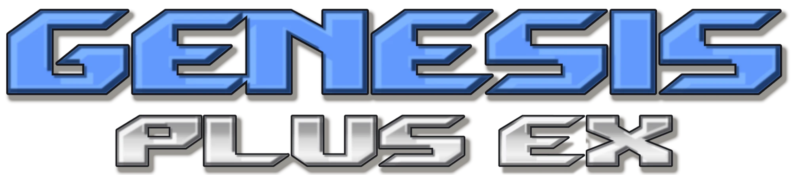
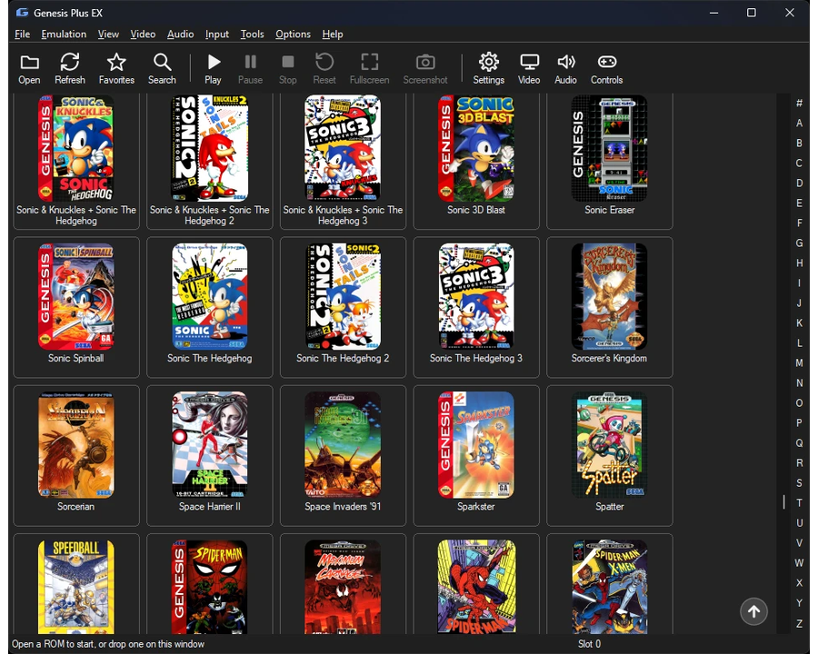
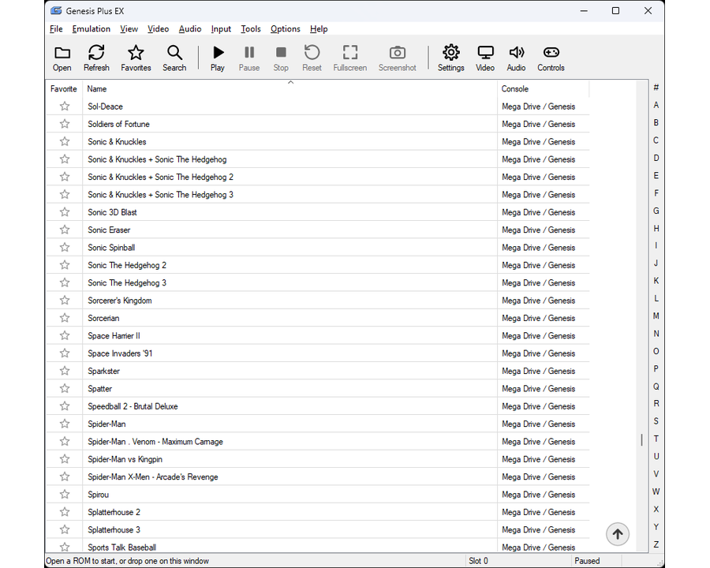
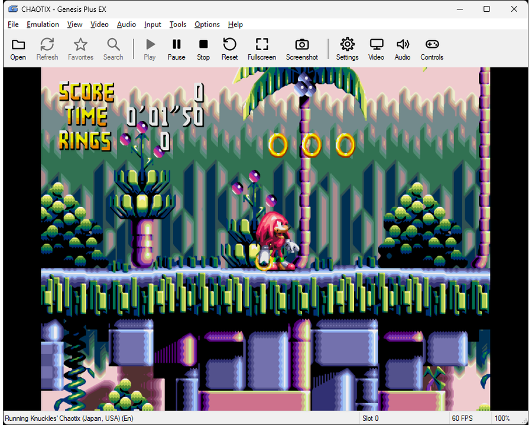
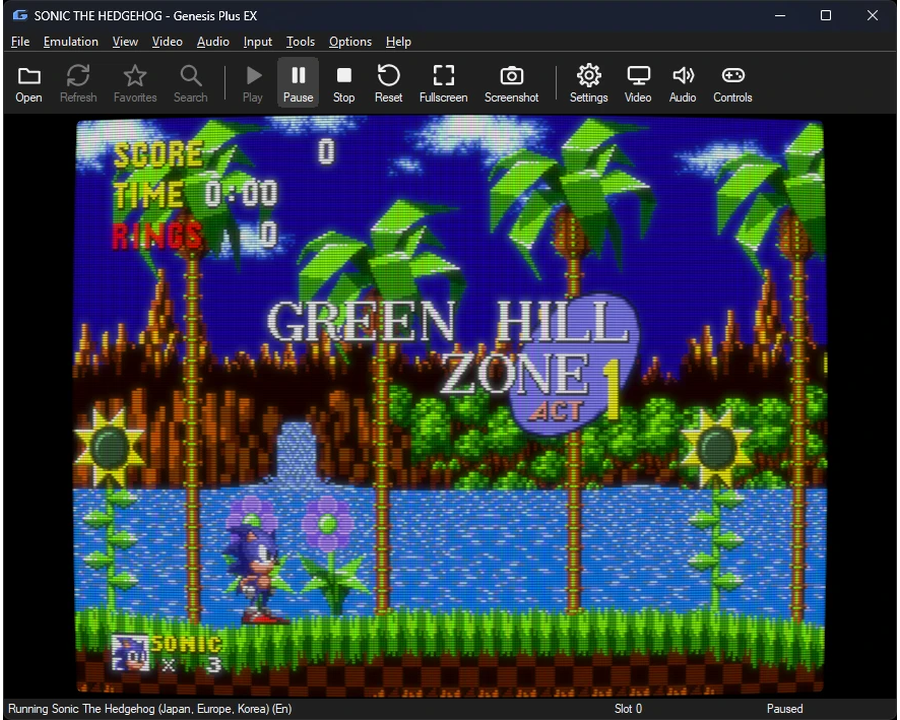
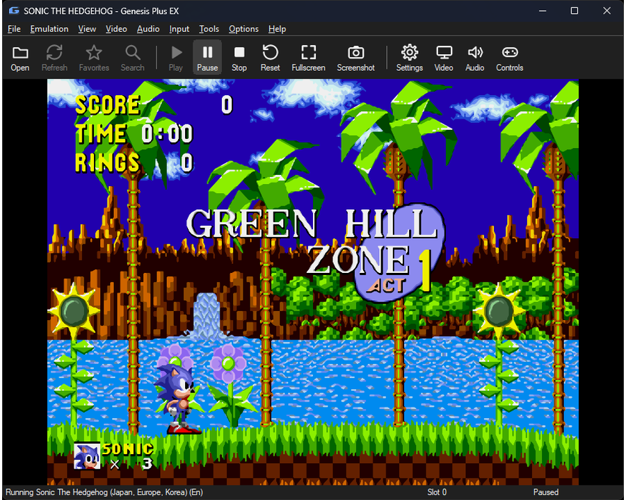
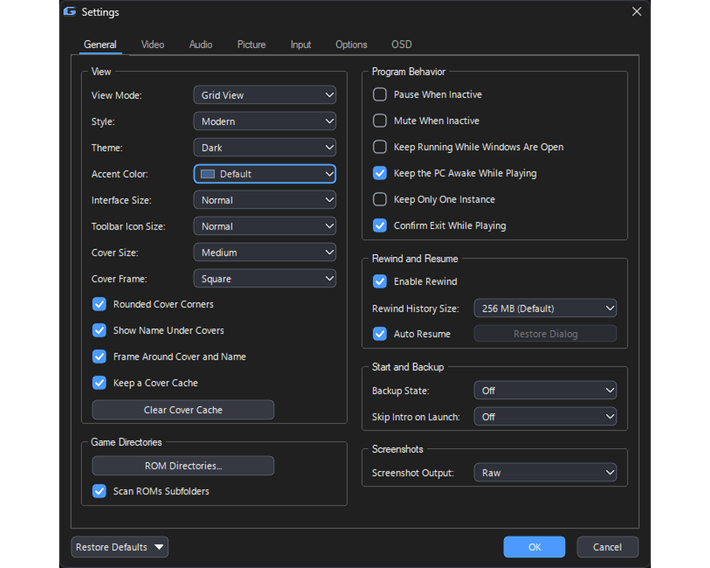
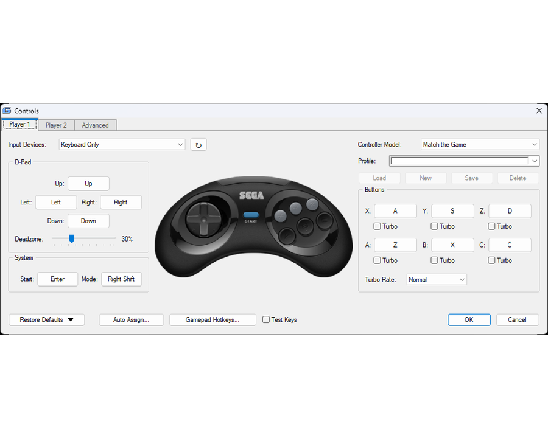

# Genesis Plus EX

**A fast, portable Windows front end for the Genesis Plus GX emulator core and, for 32X games, PicoDrive.**

Genesis Plus EX plays Sega Mega Drive / Genesis, Master System, Game Gear,
SG-1000, Mega CD / Sega CD, Pico and 32X games. It is a native Windows program that
talks straight to the emulator core, with no SDL and no installer: one `.exe`
that uses only DLLs that ship with Windows, and keeps everything it saves in
plain folders next to itself.

It lives in the `win32/` folder of this repository, next to the original `sdl/`
and `gx/` ports, and does not change the core.

By [Hazem Abdelghani](https://github.com/hazem-abdelghani/genesis-plus-ex).
Based on [Genesis Plus GX](https://github.com/ekeeke/genesis-plus-gx) by Eke-Eke (core by Charles MacDonald);
32X games run in [PicoDrive](https://github.com/notaz/picodrive) by Dave, notaz, irixxxx and others. See [License](#license) for the other libraries used.

---
⚠️ **Please do not open issues on Genesis Plus GX for Genesis Plus EX.** ⚠️

## Contents

1. [Highlights](#highlights)
2. [Screenshots](#screenshots)
3. [Quick Start](#quick-start)
4. [Where Things Are Kept](#where-things-are-kept)
5. [Controls](#controls)
6. [The Game List](#the-game-list)
7. [Saving Your Game](#saving-your-game)
8. [Picture](#picture)
9. [Sound](#sound)
10. [Cheats](#cheats)
11. [Recording and Screenshots](#recording-and-screenshots)
12. [Netplay](#netplay)
13. [32X Games](#32x-games)
14. [Starting It from the Frontends Launcher](#starting-it-from-the-frontends-launcher)
15. [Building from Source](#building-from-source)
16. [Source Layout](#source-layout)
17. [License](#license)

---

## Highlights

| | |
|---|---|
| **Systems** | Mega Drive / Genesis, Master System, Game Gear, SG-1000, Mega CD / Sega CD (multi-disc too), Pico, 32X (through PicoDrive) |
| **Files** | `.zip`, `.gz` and `.7z` open directly; Mega CD from `.cue`, `.chd` or `.bin`; 32X from `.32x` |
| **Picture** | GDI, Direct3D 9 or Direct3D 11; 40+ built-in render filters in families (xBRZ, real HQx, xBR, LQ2x, ScaleFX, CRT Geom, Super Eagle, 2xSaI, bicubic, Lanczos, scanlines, aperture grille and more); RetroArch `.slangp` shader presets (Direct3D 11, 64-bit); NTSC filter, scanlines, LCD ghosting, interlaced mode, integer scaling, bezels; Picture Adjustments (Contrast, Saturation, Gamma, Hue) |
| **Sound** | Five FM chip emulations, low-pass filter or 3-band EQ, stereo width, bass boost, WASAPI / XAudio2 / waveOut output |
| **Input** | Keyboard and XInput gamepads, remappable per player; every Sega peripheral (mouse, light guns, Team Player, EA 4-Way Play and more); turbo, combos, profiles |
| **Saving** | 10 save-state slots with thumbnails, rewind, auto resume, rolling backup states, undo for a state load |
| **Library** | List or grid game browser with cover art, search, filters, favorites, recently played, several folders |
| **Cheats** | Game Genie, Action Replay and work RAM byte codes with a Status for each, a Cheat Code Converter, Similar Cheat Files, `.cht` import and export, cheats in netplay, 32X SH-2 memory in Cheat Search |
| **Controls** | Per-player remapping, a Combos list, turbo rate, editable hotkeys (also on the gamepad), controller profiles, Hide Mouse Pointer |
| **Tools** | ROM patching (IPS, BPS), ROM Information, Insert Disc, game speed and frame advance, netplay, User Guide |
| **Extras** | Cheats and a cheat finder, input recording, video / audio / GIF / VGM recording, screenshots, LAN netplay |
| **Looks** | Light and dark themes, accent colors, a Classic or Modern style, Large interface |
| **Portable** | No installation; copy the folder to a USB stick and it keeps working |

---

## Screenshots

| | |
|---|---|
|  |  |
| Grid view with cover art (dark theme, Modern style) | Game list (light theme) |
|  |  |
| A 32X game (Knuckles' Chaotix, run by PicoDrive) | CRT look |
|  |  |
| Mega Bezel shader with a bezel | xBRZ filter + Smooth Scaling |
|  |  |
| Settings (Modern style, dark theme) | Controls window |

---

## Quick Start

1. Put `Genesis Plus EX.exe` in a folder of its own and run it. It creates its
   data folders next to itself on first start.
2. Open a game in any of these ways:
   - **File → Open ROM** (Ctrl+O),
   - drag a game onto the window,
   - **File → ROM Directory** (Ctrl+R) to browse a folder of games,
   - pass the game on the command line.
3. Play. The keyboard works at once (see [Controls](#controls)); a connected
   gamepad needs no setup either.

Both a 64-bit (`Genesis Plus EX.exe`) and a 32-bit (`Genesis Plus EX-32bit.exe`)
build exist. The 32-bit one has no shaders, because the shader library has
no 32-bit version.

Most settings are in **Options → Settings...** (tabs: General, Video, Audio,
Picture, Input, Options, OSD). Hover over any option for a short description.
**Help → User Guide** inside the program explains every menu item and the Settings, Controls, Cheats and Netplay windows.

Windows 10 version 1903 or later is recommended: it lets game and folder names
use any language. Older Windows still works with its own code page.

---

## Where Things Are Kept

Everything is relative to the program, so the folder can be moved or copied.

```
Genesis Plus EX.exe
Plugins/               the DLLs the program loads when needed: librashader.dll (shaders) and
                       picodrive_libretro-64.dll / -32.dll (the 32X emulator, PicoDrive)
genesis-plus-ex.ini    all settings
BIOS/                  optional BIOS and add-on ROMs
Saves/                 battery saves (.srm) and Mega CD backup RAM (.brm; MegaCD/cart.brm is the Mega CD's 512 KB RAM cartridge, extra save space)
States/                save states
Screenshots/           PNG screenshots, one folder per console
Cheats/                cheat lists (.cht), one folder per console (the console folders of Cheats and Covers are made at the first start, to put files in;
                       `Other`, for a game that is no known console, is made when needed)
Covers/                cover art, one folder per console, matched to games by file name
Recordings/            Video, Audio, GIF, VGM and Input recordings (a folder each, and in it a folder per console)
Profiles/              controller profiles
Shaders/               shader presets you pick (created on first use)
Bezels/                bezel images
Logs/                  genesis-plus-ex.log (Enable Log) and the crash report and dump (Enable Crash Report)
```

Saves, states and covers are grouped per console and per game:

```
Saves/MegaDrive/Sonic The Hedgehog/Sonic The Hedgehog.srm
states/MasterSystem/Alex Kidd/Alex Kidd.gp0
covers/MegaDrive/Sonic The Hedgehog.png
```

The console folders are `MegaDrive`, `MasterSystem`, `GameGear`, `SG1000`, `MegaCD` and
`32X` (and `Pico` for Sega Pico games, found by their header, also inside zip and 7z archives). **File → Open Genesis Plus EX Folder** opens the program folder.

### BIOS and Add-on ROMs (Optional)

Put these in `BIOS/`. Cartridge games run without any of them. Mega CD games
need the BIOS for their region.

| File | Used for |
|---|---|
| `bios_CD_U.bin`, `bios_CD_E.bin`, `bios_CD_J.bin` | Mega CD, by region (**required** for Mega CD) |
| `bios_MD.bin` | Mega Drive start-up (TMSS) ROM |
| `bios_U.sms`, `bios_E.sms`, `bios_J.sms`, `bios.gg` | Master System / Game Gear start-up ROMs |
| `ggenie.bin`, `areplay.bin` | Game Genie, Action Replay |
| `sk.bin`, `sk2chip.bin` | Sonic & Knuckles lock-on |
| `32X_G_BIOS.BIN`, `32X_M_BIOS.BIN`, `32X_S_BIOS.BIN` | 32X BIOS (Genesis, Master SH-2, Slave SH-2): **not needed and not used**; PicoDrive starts 32X games without them |

Turn the start-up ROMs on with **Settings → Options → Boot from BIOS When
Available**.

---

## Controls

### Keyboard Defaults (Player 1)

| Key | Mega Drive pad |
|---|---|
| Arrow keys | D-pad |
| Z, X, C | A, B, C |
| A, S, D | X, Y, Z |
| Enter | Start |
| Right Shift | Mode |

### Gamepad Defaults (XInput)

The left stick and D-pad move. X, A and B give A, B and C; Y gives X; RB gives
Y; RT gives Z; Start is Start and Back is Mode. LB fast-forwards and LT rewinds.
The right stick is a set of four extra buttons that can be assigned like any
other, and by default it does the save-state shortcuts.

### Changing the Controls

**Input → Controls...** has a tab for Player 1, Player 2 and an Extras tab.

- Click a button, then press the key or gamepad button you want. The same
  press works for keyboard and pad; there is no separate mode. **Esc** or a
  right click cancels. **Auto Assign** goes through all the buttons in turn.
- A key or button can only be on one pad button; assigning it takes it from
  the old one and a line under the pad says so.
- **Turbo** is a box beside A, B, C, X, Y and Z; **Turbo Rate** sets how fast: Slower (7.5 presses a second), Slow (10), Medium (15, the default), Fast (22.5) or Faster (30).
- **Deadzone** sets how far a stick must move before it counts.
- **Controller Model** and the **Extras** tab choose what is plugged into
  each port: Control Pad, Mouse, Light Phaser, Menacer, Justifier, XE-1AP,
  Activator, Paddle Control, Sports Pad, Graphic Board (Pico), Team Player,
  EA 4-Way Play, Master Tap or Smash Controller.
- **Profiles** (Load / New / Save / Delete) keep whole control setups, both
  players, pad types and combos, in the `Profiles` folder.
- **Gamepad Hotkeys...** puts shortcuts on pad buttons: fast forward, rewind,
  turbo, states and slots, pause, reset, screenshot, fullscreen, mute, the frame rate,
  recording, game speed and an in-game pause menu. An optional hold button
  keeps the pad free for the game until it is held.
- **Input → Enable Background Input** keeps pad input working while another
  window has focus.

### Combo Buttons

On the Extras tab, one key or pad button can press several game buttons.
Pick a row, choose the **Trigger**, then click the game buttons to add. **Hold**
keeps a button down for a time (0.25 to 10 seconds) or until you press it
yourself, and **Pause** waits before the next one, so `Gamepad Y → Down (Hold
1.0 s) + A` is a Sonic spin dash on one button. Up to 12 combos; **How It
Works** in the window has an example.

### Keyboard Shortcuts

Every shortcut can be changed in **Input → Hotkeys...**. The defaults:

| Shortcut | Action |
|---|---|
| Ctrl+O / Ctrl+R | Open a ROM / ROM Directory |
| F2 / F3 | Pause / Stop |
| F4 / Ctrl+F4 | Reset / hard reset |
| F5 / F8 | Save / load the selected state slot |
| 0 – 9 / Shift+0 – 9 | Load / save that slot directly |
| F6 / F7 | Previous / next slot |
| Ctrl+F5 / Ctrl+F8 | Undo the last save / load |
| Tab (hold) | Fast forward |
| Backspace (hold) | Rewind |
| Ctrl++ / Ctrl+- / Ctrl+0 | Game speed faster / slower / normal (25 – 400 %) |
| `\` | Advance one frame while paused |
| Alt+Enter, Esc | Fullscreen |
| Ctrl+M / Ctrl+N / Ctrl+B / Ctrl+P | Mute all / FM / PSG / PWM (32X games) |
| Ctrl+T | Show / hide the frame rate |
| Ctrl+C | Cheats |
| Ctrl+F | Search the game list |
| F12 | Screenshot |
| Shift+F11 / Ctrl+F11 / Ctrl+F12 / Alt+F11 | Record video / audio / GIF / stop |
| Shift+F10 | Record a VGM file |
| F1 | List of shortcuts |

---

## The Game List

**File → ROM Directory** (Ctrl+R) shows your games. Double-click one to play,
or right-click for more: play with a saved state, edit its cheats, cover image,
favorite, remove from recently played, create a desktop shortcut. Right-click on empty
space shows the same menu with the choices for a game grayed. With more than one ROM
folder set, *Open ROM Directory* opens a list of them.

- **List or grid.** **View → View Mode**. The grid shows cover art; its size
  runs from Tiny to Extra Large (Ctrl + mouse wheel sets any size) and the
  shape, rounded corners, captions and a card frame are in Settings → General.
  Covers are cached so they appear at once the next time.
- **Search and filters.** Type in the search bar (Ctrl+F). Search words narrow
  by one field: `region:usa`, `console:mega cd`, `genre:action`, `type:chd`,
  `fav:yes`. The filter bar narrows by console, genre and region.
- **Several folders.** **Settings → General → ROM Directories...** adds more
  folders, removes any of them, and excludes folders from the scan. Subfolders
  are scanned too.
- **Window.** **View → Always on Top** (also in Settings → General) keeps the window above all others, and *Reset Window Size* puts it back at the
  size set under Video.
- **Tidy names.** *Clean Game Names* hides tags like `(USA, Europe) [!]`, in the
  list and in File → Recent Files.
- **Recently played, favorites, groups.** A *Recently Played* group at the top (those games are in the full list too),
  stars for favorites (and *Show Favorites Only*), *Group by Console*, an A–Z
  strip (pressing a letter again goes to the next console's games with it), and sortable columns (Genre, Region, File Size, File Type and more).
- **Typing** a letter jumps to the game that starts with it.
- **Dropping files.** A game opens, a `.cht` file is imported and a `.gpstate`
  file loads into the running game.

**Multi-disc Mega CD games** (such as *Lunar: Eternal Blue*) ask for the next
disc themselves, as on a real console; pick the file and the game carries on
with no reset. **File → Insert Disc...** does it by hand.

---

## Saving Your Game

- **Save states.** Ten slots, each with a thumbnail and the time it was saved.
  **Manage States...** shows them all; right-click a slot (also an empty one) to save to it, copy it
  to a file (*Save This Slot As...*) or delete it; double-click an empty slot to save to it. States can also be saved to
  and loaded from any `.gpstate` file to share them.
- **Undo.** *Undo Load State* and *Undo Save State* go back one step.
- **Rewind.** Hold Backspace to run recent play backwards. A bar shows how much
  history is left. History size is 128 to 768 MB (256 MB by default); Rewind Speed is Slow, Normal (the default), Fast or Very Fast.
- **Auto Resume** (on by default). The game is saved when you close it and you
  are asked whether to carry on next time. The exit question has a
  *Resume this game next time* box.
- **Backup State.** Optionally saves quietly every 1 to 10 minutes into three
  rolling backups (**Load State → Load Backup State**).
- **Skip intro.** Optionally runs the first few seconds of a game at full speed.
- **Battery saves** are written automatically as `.srm` / `.brm` files.

---

## Picture

### Renderer, Size and Shape

- **Video → Renderer:** GDI (CPU), Direct3D 9 or Direct3D 11. Each falls back
  to GDI by itself when it is not available.
- **Window Size** 1× to 6× (3× by default), fullscreen as a borderless window or
  exclusive with its own resolution, hide the mouse pointer after
  a few seconds.
- **Aspect Ratio:** *Original Console Pixels* (the default, the Mega Drive's own
  pixel shape), 1:1, 4:3 or 16:9. **Integer Scaling** keeps every pixel the same
  size. **Smooth Scaling**, border color, overscan borders and interlaced mode
  (single or double field) are all options. In a game that draws a 448-line picture (Sonic 2's two player mode) *Single Field* shows the same
  half of it every frame, so it stays steady; *Double Field* shows all 448 lines, with the moving parts smoothed so they have no comb teeth.
- **Picture adjustments:** Contrast, Saturation, Gamma and Hue (sliders in **Video → Picture Adjustments...**, with *Restore Defaults* and *Cancel*) and Brighten;
  **Flicker Blending** (makes games that flash an object every other frame to
  fake transparency look solid); **Dither Smoothing**; a **Bezel Image**
  drawn around the picture in fullscreen.
- **Effects:** the Blargg **NTSC filter** (composite, S-Video or RGB),
  **Scanlines** (25 – 100 %), **LCD Ghosting**.

### Render Filters

**Video → Render Filter** applies a pixel filter before the picture is scaled
to the window. They are built into the program.

| Filter | Result |
|---|---|
| Scale2x, Scale3x | Smooths diagonals of pixel art and keeps the rest |
| ScaleFX 3x | Sp00kyFox's ScaleFX: follows edges up to level 6 with smooth changes of slope, and only uses colors that were in the picture (ported from its shader; a little heavier on the processor) |
| Eagle 2x | Classic Eagle rules; can thin single-pixel lines |
| 2xSaI | The classic "Scale and Interpolate" look: smooth, slightly soft diagonals |
| Super Eagle | A smoother Eagle: keeps diagonals going and blends the corners |
| Super 2xSaI | A softer 2xSaI: more blending along lines |
| Smooth 2x / 4x | Edge-directed corner smoothing; crisp and cheap |
| HQ2x / HQ3x / HQ4x | The real hqx by Maxim Stepin: smooth corners that keep the pixel art's shapes |
| LQ2x | A lighter, faster cousin of hq2x |
| xBR 2x / 3x / 4x | Hyllian's xBR: smooth diagonals and curves, sharp edges (a close relative of xBRZ) |
| **xBRZ 2× to 6×** | The real xBRZ: smooth curves and clean thin lines; slightly softer |
| Sharp 4x | Pixel replication; with *Smooth Scaling* on it gives the "sharp bilinear" look |
| Sharp Bilinear 3x / 4x | Crisp pixels with a short blend along each seam, so edges look clean when the picture is resized |
| Lanczos 3x / 4x | A real resampling filter: smooth and non-pixelated, with sharp edges |
| Catmull-Rom 3x / 4x | A bicubic resampling filter: smooth, with crisp edges (like Lanczos, a little gentler) |
| Mitchell 3x / 4x | A bicubic filter between sharp and soft |
| B-Spline 3x / 4x | The softest bicubic filter: smooth, no ringing at hard edges |
| Scanlines 2x / 3x / 4x | Rows dimmed (3x and 4x have a bright middle and dimmer edges, like a beam) |
| Glow Scanlines 3x | Scanlines where bright pixels keep their beam and bleed a little sideways |
| CRT 3x (RGB Mask) | Red / green / blue phosphor stripes plus scanlines |
| CRT Aperture Grille 3x | Trinitron-style stripes with hardly dimmed rows |
| CRT Geom 3x / 4x | The classic CRT-Geom: curved glass with rounded corners, beams that widen with brightness, a dot mask and the CRT's gamma (ported from its shader; **very heavy**, it uses up to four processor threads) |
| CRT Shadow Mask 3x | Staggered phosphor dots with darker rows between them |
| LCD Grid 3x / 4x | The pixel grid of a handheld screen (use *LCD Ghosting* in View > Visual Effects for the ghosting) |

The **Render Filter** menu lists the filters sorted by name, with each family (Bicubic, CRT, HQ, Lanczos, LCD Grid, Scale,
Scanlines, Sharp, Smooth, xBR, xBRZ) in a sub-menu of its own.

A render filter and the NTSC filter cannot be on together. xBRZ keeps a 64 MB
table while it is selected (about 80 – 100 MB extra) and frees it when you
switch away.

### Shaders

**Video → Render Filter → Shaders → Preset...** loads a RetroArch-style
`.slangp` preset (CRT looks, phosphor masks, upscalers) through
[librashader](https://github.com/SnowflakePowered/librashader). It needs the
**Direct3D 11** renderer and the **64-bit** program, and `librashader.dll` must
be in the `Plugins` folder next to the `.exe` (it is included; next to the `.exe` also works). **Shader Parameters...** adjusts the
preset's own settings while it runs.

### Looks of the Program

- **Theme:** System, Light or Dark.
- **Style:** *Classic*, or *Modern* with flat rounded buttons, check boxes,
  drop-downs and tabs, softer toolbar buttons,
  rounded window corners and a themed title bar (Windows 11), and Segoe UI text.
- **Accent Color:** Blue, Brown, Crimson, Gold, Gray, Green, Indigo, Lime, Magenta, Navy, Olive, Orange, Pink, Purple, Red, Sky Blue, Teal, Violet or Yellow, for
  selections, tabs and list headings.
- **Colorful Icons:** the icons of the menus, the toolbar and the favorite star in color, one color for each kind of
  action (off by default: black and white, in the color of the text).
- **Interface Size:** Normal or Large (the program restarts to change it).
- **On-screen messages (Settings → OSD):** position, size, color, time (1 – 7
  seconds), how many show at once (1 – 7), and a frame-rate counter.

---

## Sound

- **Output:** Windows Classic (waveOut), XAudio2, WASAPI shared (the default) or
  WASAPI exclusive, at 44100 or 48000 Hz, with a choice of sound device.
- **FM chip:** YM2612 or YM3438, either the cycle-accurate Nuked versions (YM2612
  Nuked is the default) or MAME (Discrete, ASIC or Enhanced). **High-Quality FM**
  is on by default. The Master System FM unit can be Auto, Off or On, with its
  own chip choice.
- **Tone:** a **low-pass filter** (adjustable strength) or a **3-band EQ**; only
  one at a time. **Console Model** presets set up a Model 1 or Model 2 sound.
  Also **Stereo Width**, **Bass Boost**, **Overdrive**, **Even Out Loudness**,
  mono output and high-quality PSG resampling.
- **Levels and Latency...:** master, FM, PSG, CD audio and Sega CD PCM volume,
  buffer size, and a live level meter.
- **Mute** all sound, FM only (Ctrl+N) or PSG only (Ctrl+B); *Mute When
  Inactive* silences the game when another window has focus. *Pause When Inactive* pauses it instead.
- Changing the FM chip or unit during a game can leave some instruments quiet
  until the game sets them again or you reset. These choices are locked during
  netplay.

---

## Cheats

**Tools → Cheats...** (Ctrl+C) keeps a list of codes for the game, saved in
`Cheats/<Console>/<game>.cht` and loaded again the next time. Tick a code to
turn it on or off at once, no reset needed. The same list opens, without
starting the game, from its right-click menu or from this menu item with the
game picked in the list.

| Console | Code types |
|---|---|
| Mega Drive / Genesis | Game Genie (`ABCD-EFGH`), raw patch (`aaaaaa:dddd`), work RAM byte (`aaaaaa:dd`, for example `FFB030:FF`) |
| Master System / Game Gear / SG-1000 | Game Genie (`ABC-DEF`, or with a reference byte), Action Replay (`00XX-YYYY`), raw RAM (`aaaa:dd`) |

- **Enable Cheats** is off until you turn it on.
- **Status column:** Active, Off (not ticked), Cheats are off, Game not running, or Code not valid for this system
  (the code is not one this console understands). Click #, Code, Description or Status to sort the list (the # is the number a cheat got when it was added; it stays with the cheat). Right-click the column titles for Size All Columns to Fit; click again
  to turn the order round.
- **Similar Cheat Files** lists other cheat files of the game's console folder that start like the game's name; choosing one loads its cheats, or, when the list already has cheats, offers Load (replace the list) or Insert (merge the file's cheats into it).
- **ROM codes after a start:** they wait for the first button press after a game starts or is reset, at least two seconds and twenty at most (a game checks its ROM first).
- **Netplay:** both PCs need the same cheats switched on before connecting; the list is compared.
- **Convert...** lists a code as Game Genie, Action Replay or raw, one form to a row.
- **Export...** saves the list as a RetroArch `.cht` file, to keep, share or use in another program (Load Cheat reads it back).
- **Shared codes:** a `.cht` file named after a game's CRC32 (for example
  `A1B2C3D4.cht`) in `Cheats/library` is used by any game with no list of its own.
- **Cheat Search...** finds where a value (lives, health, ammo, a score) is kept
  in memory, so you can make a cheat without a code: *First Scan*, change the value in the game, pick a comparison and *Next Scan*, and repeat until a few
  addresses are left. The Memory choice (work RAM, Mega CD memory, 32X SDRAM) is remembered for the same game while the program runs, and so is the
  scan itself when the window is closed (until the game stops).

---

## Recording and Screenshots

| Action | Where | Shortcut |
|---|---|---|
| Video + audio | `Recordings/Video/<Console>/` (`.mp4`, H.264 + AAC) | Shift+F11 |
| Audio only | `Recordings/Audio/<Console>/` (`.wav`) | Ctrl+F11 |
| Animated GIF (up to 6 s, picture only) | `Recordings/GIF/<Console>/` | Ctrl+F12 |
| VGM sound log | `Recordings/VGM/<Console>/` (`.vgm`) | Shift+F10 |
| Input recording (`.gpm`) | `Recordings/Input/<Console>/` | Tools → Record Input |
| Stop any of them | | Alt+F11 |
| Screenshot | `Screenshots/<Console>/` (`.png`) | F12 |

Files are named after the game and the time. **Settings → Options → Screenshot
Output** chooses what a screenshot contains: *Corrected* (the default:
the picture stretched to the 4:3 shape of a TV, 640×480), *Raw* (the console's own picture at its
own size, not stretched) or *Final* (like Corrected, with the render filter applied). **Screenshot Size** makes it 1×, 2×, 3× or 4× that size (Raw is enlarged in whole pixels, so it stays sharp). Scanlines and Brighten are never included.

**Settings → Options → Video Recording** sets the size (1×–4× the console's own picture; 2× by default), the quality (automatic or 4–32 Mbit/s) and the shape (the console's own, 4:3 or 16:9) of a video recording.

**Tools → Record Input** saves a state and every button you press afterwards
to a `.gpm` file (named after the game and the time, like the other recordings); *Play Input Recording...* replays it exactly. Use the same
game. Handy for speedruns and bug reports.

---

## Netplay

Two people on the same network can play together (**Tools → Netplay...**).
It is lockstep without rollback, so it suits a LAN best.

1. Both load the **same ROM**, use the **same `.exe`** and the same settings.
2. The host picks a port (default 55455), an input delay (1 – 4 frames) and
   optionally a session code, then presses **Host**.
3. The guest presses **Find hosts**, chooses the host (or types its address),
   enters the code and presses **Join**.

The host is Player 1 and the guest Player 2; each uses their own Player 1
controls. Both games reset and start together. The status bar shows the ping.

- Only cartridge games work (not Mega CD), and both ports need a Control Pad.
- Pause, reset, states, cheats, rewind, fast forward and emulation settings are
  locked during a session. Cheats work: both PCs must have the same cheats switched on before connecting (Cheats is one of the settings compared; the cheat dialog is locked during a session).
- A setting that differs between the PCs refuses the connection and names it.
  The games are compared every second; if they drift apart the session ends.
- If the link drops, both sides wait up to a minute and carry on from the same
  frame.
- *Open the port on my router automatically* (UPnP, off by default) lets friends
  outside your network join with your public address. Otherwise forward the
  port yourself. Windows Firewall may ask to allow TCP 55455 and UDP 55456.
- The session code only prevents joining the wrong machine; nothing is encrypted.

---

## 32X Games

Sega 32X games (`.32x` files, or a `.bin`, `.zip` or `.7z` that has the "SEGA 32X" header) run on
[PicoDrive](https://github.com/notaz/picodrive), because Genesis Plus GX has no 32X. PicoDrive is built as a
small library, `picodrive_libretro.dll`, that sits in the `Plugins` folder next to the program (it is included; next to the program also works). The program loads it
only when a 32X game is opened. The picture, the sound, the controls, the save states and the recording are
the program's own, so the render filters, shaders, scaling, screenshots, volume and the rest work as they
do for other games.

- **Controls:** six-button pads on both ports, with the keys and buttons you have set up (turbo and combos too).
- **Saves:** states, backup states, Auto Resume and battery saves work, in a `32X` folder of their own
  (`Saves/32X/...`, `States/32X/...`). A state of a 32X game does not load into another console's game.
- **Speed:** the 32X has two extra SH-2 processors. The library runs them with a plain interpreter, which
  keeps it simple and safe but needs a reasonably fast PC.
- **Cheats:** Game Genie, Action Replay and raw codes (`AAAAAA:DDDD`) work for the Mega Drive half of a 32X game: its cartridge ROM
  and the 68000's 64 KB work RAM. The SH-2 processors' memory (the 256 KB SDRAM the two 32X processors share) can be
  patched too, with a code `06AAAAAA:DD` for a byte or `06AAAAAA:DDDD` for a word (`AAAAAA` is the address, 0 to 3FFFF within that
  memory); Cheat Search has a *32X SDRAM (SH-2)* choice under Memory to find such addresses. The cheats are kept in the `32X`
  folder under `Cheats`.
- **Rewind:** works too (it keeps PicoDrive's own states, about 680 KB each, so the same Rewind History Size holds fewer seconds of play than for
  a Mega Drive game, and the 32X needs a bit more of the PC for it).
- **Also work:** input recording and playback (the recording starts from a state of the game), the Region setting (the library
  changes its region, and with it 50 or 60 Hz, at once), the Low-Pass Filter (the library's own, with the same range), Mute FM,
  Mute PSG (the PWM sound of the 32X has its own **Mute PWM Sound** in Audio > Mute, and a **PWM Preamp** slider in Levels and Latency) and LCD Ghosting.
- **VGM recording:** logs the FM chip, the PSG and the 32X PWM to a `.vgm` file (format 1.71), starting with the state the chips are in, so a
  recording that begins while a song plays still has its instruments (also after a state was loaded: the FM chip is read back, for a Mega Drive game with either kind of FM chip and for a 32X game); the end of the file releases every held note and turns the PSG down. Most of a 32X game's music is PWM, which only some players can
  play (libvgm-based ones); the FM and PSG parts play anywhere.
- **Netplay:** works between two PCs with the same game file and program version. Both start the game again from power-on (the library is
  loaded afresh and the start-up frames run with no button pressed) and compare a fingerprint of the whole machine once a second. It needs
  PicoDrive to run exactly the same on both PCs; if it does not, the session ends with a message. Mute FM and Mute PSG are off during netplay.
- **Also for 32X games:** FM Chip (PicoDrive has two chip types, YM2612 and YM3438, so the YM3438 kinds play as a YM3438 and the others as a YM2612),
  the Console Model presets, High-Quality FM Synthesis (switches PicoDrive's FM filtering), the 3-Band EQ, the Sample Rate and the FM and PSG levels of Levels and Latency (the CD audio and PCM levels are for Sega CD games and are grayed out).
- **Not for 32X games:** the settings that belong to the Genesis Plus GX core: the Master System FM unit and chip,
  and the controller types other than the six-button pad (mouse, light gun, multi-tap; the port and controller model drop-downs in Controls are
  grayed out too). These are grayed out in the menus and in Settings while a 32X game runs. High-Quality PSG, Borders, Interlaced Mode, Console and Force VDP Mode stay available (they are kept for the other games; Force VDP Mode also sets the 32X game to NTSC or PAL). The **NTSC Filter** works for 32X games too, as the
  program's own version of the look (Composite blurs brightness and color, S-Video only the color, RGB a little); the picture keeps its size.

The 64-bit program needs the 64-bit PicoDrive library and the 32-bit program the 32-bit one. They are named
`picodrive_libretro-64.dll` and `picodrive_libretro-32.dll`, so both can stay in the `Plugins` folder.

---

## Starting It from the Frontends Launcher

The game is the last argument. Options go in front (a leading `-` or `--`).

| Option | Effect |
|---|---|
| `-f`, `--fullscreen` | Start in fullscreen (for this launch only) |
| `-w`, `--windowed` | Start in a window |
| `-x`, `--exit-on-close` | Quit when the game stops, so the launcher gets control back |
| `-s N`, `--state N` | Load save-state slot N (0 – 9) once the game has started |
| `--state-file FILE` | Load a state file |
| `-m`, `--mute` | Start muted |
| `-p`, `--paused` | Start paused |
| `--scale N` | Window size, 1 to 6 times the picture |
| `-h`, `--help` | List the options |

```
"Genesis Plus EX.exe" --fullscreen --exit-on-close "C:\Roms\Sonic The Hedgehog (USA, Europe).zip"
```

For a multi-disc Mega CD game give the first disc's `.cue` or `.chd`.

32X games (`.32x`, or a `.bin`, `.zip` or `.7z` with the "SEGA 32X" header) are started the same way; the PicoDrive files in `Plugins` have to stay beside the program.

| Launcher | Setup |
|---|---|
| LaunchBox | Add the program as an emulator, put `--fullscreen --exit-on-close` in the default command-line parameters |
| Pegasus | `launch: "C:\Emulators\Genesis Plus EX.exe" --fullscreen --exit-on-close "{file.path}"` |
| Playnite | Arguments `--fullscreen --exit-on-close "{ImagePath}"` |
| ES-DE, EmulationStation, RetroBat | `"C:\Emulators\Genesis Plus EX.exe" --fullscreen --exit-on-close %ROM%` |
| Steam ROM Manager and others | Anything that runs `"Genesis Plus EX.exe" [options] "<rom>"` |

**Settings → General → Keep Only One Instance** makes a second start (or a
double-clicked game file) open the game in the copy that is already running.

---

## Building from Source

You need MinGW-w64 (with `g++`), zlib and `make`. Nothing else. The same source
builds a 32-bit or a 64-bit program, depending on the compiler.

### On Windows (MSYS2)

1. Install [MSYS2](https://www.msys2.org/) with the defaults.
2. Open **MSYS2 MINGW64** (64-bit) or **MSYS2 MINGW32** (32-bit) from the Start
   Menu, not the plain "MSYS2" shortcut.
3. First time only: `pacman -Syu` (reopen the window if it asks you to).
4. Install the tools:
   ```sh
   pacman -S mingw-w64-x86_64-gcc mingw-w64-x86_64-zlib make     # MINGW64
   pacman -S mingw-w64-i686-gcc   mingw-w64-i686-zlib   make     # MINGW32
   ```
5. Go to the `win32` folder (drives appear as `/c`, `/d`, ...) and build:
   ```sh
   cd /c/path/to/genesis-plus-gx/win32
   make -f Makefile.win32
   ```

`Genesis Plus EX.exe` appears in the `win32` folder and runs on its own.

### Cross-Compiling on Linux

```sh
sudo apt install mingw-w64 libz-mingw-w64-dev make
cd win32
make -f Makefile.win32 CROSS=x86_64-w64-mingw32-      # 64-bit
make -f Makefile.win32 CROSS=i686-w64-mingw32-        # 32-bit
```

To keep both builds side by side, give each its own folder and name:

```sh
make -f Makefile.win32 CROSS=x86_64-w64-mingw32- OBJDIR=./build_w64 NAME="Genesis Plus EX.exe"
make -f Makefile.win32 CROSS=i686-w64-mingw32-   OBJDIR=./build_w32 NAME="Genesis Plus EX-32bit.exe"
```

### Options

| Option | Effect |
|---|---|
| `DEBUG=1` | Keep symbols, no optimization |
| `CHD=0` | No `.chd` and `.7z` support (skips libchdr and its lzma / zstd code) |
| `OGG=0` | No OGG CD audio (skips the bundled Tremor decoder) |
| `PICO=0` | Does not build `picodrive_libretro.dll` (the 32X emulator); the program then cannot run 32X games |
| `PICODRC=1` | Builds the PicoDrive SH-2 dynamic recompiler too (faster 32X, but not tested on Windows) |
| `PICONAME=name.dll` | Gives the library another file name, to keep the 64-bit and 32-bit ones in one folder |

`CHD` and `OGG` are on by default and build from sources in the repository.
Turning them off roughly halves the build time if you only play cartridges.

Headers in angle brackets, such as `<windows.h>` or `<d3d11.h>`, come with the
MinGW-w64 compiler; only headers in quotes are files of this project.

---

## Source Layout

Everything for this front end is in `win32/`. The files `fileio.c`, `unzip.c`
and `error.c` are reused from `../sdl`, and the include path puts `win32/` first
so the core sees this port's `osd.h`.

| File | Role |
|---|---|
| `main.c` | Window, menus, game start and stop, the emulation loop |
| `video.c`, `d3d9_video.c`, `d3d11_video.c` | Picture: scaling, renderers, fullscreen, on-screen text, screenshots |
| `filters.c`, `xbrz_glue.cpp`, `xbrz/`, `xbr/` | Built-in render filters, including xBRZ, xBR and HQx |
| `shader_chain.c`, `librashader/` | Shader presets through `librashader.dll` |
| `audio.c`, `audio_be.c` | Sound output and the sound backends |
| `input.c`, `hotkeys.c` | Keyboard, XInput, pointer devices, combos, shortcuts |
| `browser.c`, `coverart.c`, `history.c` | Game list, grid and covers, play history |
| `cheats.c`, `patches.c` | Cheats and ROM patches |
| `dialogs.c`, `settings.c`, `theme.c`, `toolbar.c` | Windows, the Settings dialog, themes and styles, toolbar |
| `recorder.c`, `movie.c`, `vgm.c` | Recording video, audio and GIF; input recording; VGM logs |
| `netplay.c`, `upnp.c` | Network play and router port opening |
| `picocore.c`, `picodrive/` | 32X games: loads the PicoDrive library and feeds it the controls, picture and sound; the PicoDrive source (built as `picodrive_libretro.dll`) |
| `sevenzip.c`, `lzmasdk/` | `.7z` archives |
| `config.c`, `config.h` | Defaults and the settings file |
| `gpex.rc`, `resource.h`, `gpex.manifest` | Menus, dialogs, accelerators, icon and visual styles |

---

## License

The same terms as Genesis Plus GX: the source must accompany modified
redistributions, and the program may not be sold or used commercially. See
`LICENSE.txt` in the repository root.

The xBR and HQx render filters (`win32/xbr/`, by Hyllian, Maxim Stepin, Cameron Zemek and Treeki) are under the GNU Lesser General Public License 2.1 or later; see `win32/xbr/README-libxbr.txt`.

ScaleFX 3x (`filters.c`) is a port of Sp00kyFox's ScaleFX shader passes (MIT license, Copyright (c) 2016 Sp00kyFox), and CRT Geom 3x / 4x a port of the CRT-Geom shader by cgwg, Themaister and DOLLS (GPL 2 or later).

PicoDrive (`win32/picodrive/`, by Dave, notaz, irixxxx and others; the 32X emulator) has terms of the same kind: it may not be
sold or used commercially, and the source must come with modified versions. Its `COPYING` file is in that folder.

Other libraries used:

| Library | By | License |
|---|---|---|
| xBRZ (`xbrz/`) | Zenju (HqMAME) | GPL, with the MAME linking exception |
| 7-Zip LZMA SDK (`lzmasdk/`) | Igor Pavlov | Public domain |
| stb_image (`stb_image.h`) | Sean Barrett | Public domain |
| librashader (`Plugins/librashader.dll`, `librashader/`) | chyyran | MIT, Apache-2.0 or MPL-2.0 |

The shader presets are the RetroArch `.slangp` / Slang format, which librashader runs.
