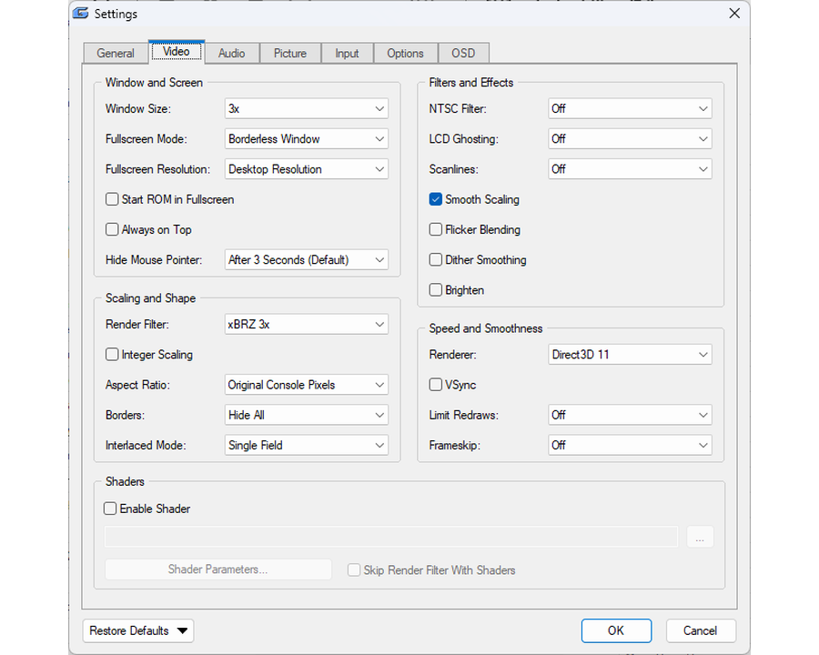

# Genesis Plus EX

**A fast, portable Windows front end for the Genesis Plus GX emulator core.**

Genesis Plus EX plays Sega Mega Drive / Genesis, Master System, Game Gear,
SG-1000, Mega CD / Sega CD and Pico games. It is a native Windows program that
talks straight to the emulator core, with no SDL and no installer: one `.exe`
that uses only DLLs that ship with Windows, and keeps everything it saves in
plain folders next to itself.

It lives in the `win32/` folder of this repository, next to the original `sdl/`
and `gx/` ports, and does not change the core.

By [Hazem Abdelghani](https://github.com/hazem-abdelghani/genesis-plus-ex).
Based on [Genesis Plus GX](https://github.com/ekeeke/genesis-plus-gx).

---

## Contents

1. [Highlights](#highlights)
2. [Screenshots](#screenshots)
3. [Quick start](#quick-start)
4. [Where things are kept](#where-things-are-kept)
5. [Controls](#controls)
6. [The game list](#the-game-list)
7. [Saving your game](#saving-your-game)
8. [Picture](#picture)
9. [Sound](#sound)
10. [Cheats](#cheats)
11. [Recording and screenshots](#recording-and-screenshots)
12. [Netplay](#netplay)
13. [Starting it from a launcher](#starting-it-from-a-launcher)
14. [Building from source](#building-from-source)
15. [Source layout](#source-layout)
16. [License](#license)

---

## Highlights

| | |
|---|---|
| **Systems** | Mega Drive / Genesis, Master System, Game Gear, SG-1000, Mega CD / Sega CD (multi-disc too), Pico |
| **Files** | `.zip`, `.gz` and `.7z` open directly; Mega CD from `.cue`, `.chd` or `.bin` |
| **Picture** | GDI, Direct3D 9 or Direct3D 11; built-in pixel filters including real xBRZ; RetroArch `.slangp` shader presets (Direct3D 11, 64-bit); NTSC filter, scanlines, LCD ghosting, integer scaling, bezels |
| **Sound** | Five FM chip emulations, low-pass filter or 3-band EQ, stereo width, bass boost, WASAPI / XAudio2 / waveOut output |
| **Input** | Keyboard and XInput gamepads, remappable per player; every Sega peripheral (mouse, light guns, Team Player, EA 4-Way Play and more); turbo, combos, profiles |
| **Saving** | 10 save-state slots with thumbnails, rewind, auto resume, rolling backup states, undo for a state load |
| **Library** | List or grid game browser with cover art, search, filters, favorites, recently played, several folders |
| **Extras** | Cheats and a cheat finder, input recording, video / audio / GIF / VGM recording, screenshots, LAN netplay |
| **Looks** | Light and dark themes, accent colors, a Classic or Modern style, Larger UI |
| **Portable** | No installation; copy the folder to a USB stick and it keeps working |

---

## Screenshots

| | |
|---|---|
|  |  |
| Grid view with cover art (dark theme, Modern style) | Game list (light theme) |
|  |  |
| CRT look | Mega Bezel shader with a bezel |
|  |  |
| xBRZ filter + Smooth Scaling | Settings (Modern style, dark theme) |
|  |  |
| Controls window | Video settings (light theme) |

---

## Quick start

1. Put `Genesis Plus EX.exe` in a folder of its own and run it. It creates its
   data folders next to itself on first start.
2. Open a game in any of these ways:
   - **File → Open ROM** (Ctrl+O),
   - drag a game onto the window,
   - **File → ROMs Directory** (Ctrl+R) to browse a folder of games,
   - pass the game on the command line.
3. Play. The keyboard works at once (see [Controls](#controls)); a connected
   gamepad needs no setup either.

Both a 64-bit (`Genesis Plus EX.exe`) and a 32-bit (`Genesis Plus EX-32bit.exe`)
build exist. The 32-bit one has no GPU shaders, because the shader library has
no 32-bit version.

Most settings are in **Options → Settings...** (tabs: General, Video, Audio,
Picture, Input, Options, OSD). Hover over any option for a short description.
**Help → Menu Guide** inside the program explains every menu item.

Windows 10 version 1903 or later is recommended: it lets game and folder names
use any language. Older Windows still works with its own code page.

---

## Where things are kept

Everything is relative to the program, so the folder can be moved or copied.

```
Genesis Plus EX.exe
genesis-plus-ex.ini     all settings
bios/                   optional BIOS and add-on ROMs
saves/                  battery saves (.srm) and Mega CD backup RAM (.brm)
states/                 save states
screenshots/            PNG screenshots
cheats/                 cheat lists (.cht), one folder per console
covers/                 cover art, matched to games by file name
recordings/             Video, Audio, GIF and VGM recordings (a folder each)
profiles/               controller profiles
shaders/                shader presets you pick (created on first use)
bezels/                 bezel images
```

Saves, states and covers are grouped per console and per game:

```
saves/MegaDrive/Sonic The Hedgehog/Sonic The Hedgehog.srm
states/MasterSystem/Alex Kidd/Alex Kidd.gp0
covers/MegaDrive/Sonic The Hedgehog.png
```

The console folders are `MegaDrive`, `MasterSystem`, `GameGear`, `SG1000` and
`MegaCD`. **File → Open Genesis Plus EX Folder** opens the program folder.

### BIOS and add-on ROMs (optional)

Put these in `bios/`. Cartridge games run without any of them. Mega CD games
need the BIOS for their region.

| File | Used for |
|---|---|
| `bios_CD_U.bin`, `bios_CD_E.bin`, `bios_CD_J.bin` | Mega CD, by region (**required** for Mega CD) |
| `bios_MD.bin` | Mega Drive start-up (TMSS) ROM |
| `bios_U.sms`, `bios_E.sms`, `bios_J.sms`, `bios.gg` | Master System / Game Gear start-up ROMs |
| `ggenie.bin`, `areplay.bin` | Game Genie, Action Replay |
| `sk.bin`, `sk2chip.bin` | Sonic & Knuckles lock-on |

Turn the start-up ROMs on with **Settings → Options → Boot from BIOS When
Available**.

---

## Controls

### Keyboard defaults (Player 1)

| Key | Mega Drive pad |
|---|---|
| Arrow keys | D-pad |
| Z, X, C | A, B, C |
| A, S, D | X, Y, Z |
| Enter | Start |
| Right Shift | Mode |

### Gamepad defaults (XInput)

The left stick and D-pad move. X, A and B give A, B and C; Y gives X; RB gives
Y; RT gives Z; Start is Start and Back is Mode. LB fast-forwards and LT rewinds.
The right stick is a set of four extra buttons that can be assigned like any
other, and by default it does the save-state shortcuts.

### Changing the controls

**Input → Controls...** has a tab for Player 1, Player 2 and an Advanced tab.

- Click a button, then press the key or gamepad button you want. The same
  press works for keyboard and pad; there is no separate mode. **Esc** or a
  right click cancels. **Auto Assign** goes through all the buttons in turn.
- A key or button can only be on one pad button; assigning it takes it from
  the old one and a line under the pad says so.
- **Turbo** is a box beside A, B, C, X, Y and Z; **Turbo Rate** sets how fast.
- **Deadzone** sets how far a stick must move before it counts.
- **Controller Model** and the **Advanced** tab choose what is plugged into
  each port: Control Pad, Mouse, Light Phaser, Menacer, Justifier, XE-1AP,
  Activator, Paddle Control, Sports Pad, Graphic Board (Pico), Team Player,
  EA 4-Way Play, Master Tap or Smash Controller.
- **Profiles** (Load / New / Save / Delete) keep whole control setups, both
  players, pad types and combos, in the `profiles` folder.
- **Gamepad Hotkeys...** puts shortcuts on pad buttons: fast forward, rewind,
  turbo, states and slots, pause, reset, screenshot, fullscreen, mute,
  recording, game speed and an in-game pause menu. An optional hold button
  keeps the pad free for the game until it is held.
- **Input → Enable Background Input** keeps pad input working while another
  window has focus.

### Combo buttons

On the Advanced tab, one key or pad button can press several game buttons.
Pick a row, choose the **Trigger**, then click the game buttons to add. **Hold**
keeps a button down for a time (0.25 to 10 seconds) or until you press it
yourself, and **Pause** waits before the next one, so `Gamepad Y → Down (Hold
1.0 s) + A` is a Sonic spin dash on one button. Up to 12 combos; **How It
Works** in the window has an example.

### Keyboard shortcuts

Every shortcut can be changed in **Input → Hotkeys...**. The defaults:

| Shortcut | Action |
|---|---|
| Ctrl+O / Ctrl+R | Open a ROM / ROMs Directory |
| F2 / F3 | Pause / Stop |
| F4 / Ctrl+F4 | Reset / hard reset |
| F5 / F8 | Save / load the selected state slot |
| 0 – 9 / Shift+0 – 9 | Load / save that slot directly |
| F6 / F7 | Previous / next slot |
| Ctrl+F5 / Ctrl+F8 | Undo the last save / load |
| Tab (hold) | Fast forward |
| Backspace (hold) | Rewind |
| Ctrl++ / Ctrl+- / Ctrl+0 | Game speed faster / slower / normal (25 – 400 %) |
| `\` | Advance one frame while paused |
| Alt+Enter, Esc | Fullscreen |
| Ctrl+M / Ctrl+N / Ctrl+B | Mute all / FM / PSG |
| Ctrl+C | Cheats |
| Ctrl+F | Search the game list |
| F12 | Screenshot |
| Shift+F11 / Ctrl+F11 / Ctrl+F12 / Alt+F11 | Record video / audio / GIF / stop |
| F1 | List of shortcuts |

---

## The game list

**File → ROMs Directory** (Ctrl+R) shows your games. Double-click one to play,
or right-click for more: play with a saved state, edit its cheats, cover image,
favorite, remove from recently played, create a desktop shortcut.

- **List or grid.** **View → View Mode**. The grid shows cover art; its size
  runs from Tiny to Extra Large (Ctrl + mouse wheel sets any size) and the
  shape, rounded corners, captions and a card frame are in Settings → General.
  Covers are cached so they appear at once the next time.
- **Search and filters.** Type in the search bar (Ctrl+F). Search words narrow
  by one field: `region:usa`, `console:mega cd`, `genre:action`, `type:chd`,
  `fav:yes`. The filter bar narrows by console, genre and region.
- **Several folders.** **Settings → General → ROM Directories...** adds more
  folders, removes any of them, and excludes folders from the scan. Subfolders
  are scanned too.
- **Tidy names.** *Clean Game Names* hides tags like `(USA, Europe) [!]`, in the
  list and in File → Recent Files.
- **Recently played, favorites, groups.** A *Recently Played* group at the top,
  stars for favorites (and *Show Favorites Only*), *Group by Console*, an A–Z
  strip, and sortable columns (Genre, Region, File Size, File Type and more).
- **Typing** a letter jumps to the game that starts with it.
- **Dropping files.** A game opens, a `.cht` file is imported and a `.gpstate`
  file loads into the running game.

**Multi-disc Mega CD games** (such as *Lunar: Eternal Blue*) ask for the next
disc themselves, as on a real console; pick the file and the game carries on
with no reset. **File → Insert Disc...** does it by hand.

---

## Saving your game

- **Save states.** Ten slots, each with a thumbnail and the time it was saved.
  **Manage States...** shows them all; right-click a slot to save to it, copy it
  to a file (*Save This Slot As...*) or delete it. States can also be saved to
  and loaded from any `.gpstate` file to share them.
- **Undo.** *Undo Load State* and *Undo Save State* go back one step.
- **Rewind.** Hold Backspace to run recent play backwards. A bar shows how much
  history is left. History size is 128 to 768 MB (256 MB by default).
- **Auto Resume** (on by default). The game is saved when you close it and you
  are asked whether to carry on next time. The exit question has a
  *Resume this game next time* box.
- **Backup State.** Optionally saves quietly every 1 to 10 minutes into three
  rolling backups (**Load State → Load Backup State**).
- **Skip intro.** Optionally runs the first few seconds of a game at full speed.
- **Battery saves** are written automatically as `.srm` / `.brm` files.

---

## Picture

### Renderer, size and shape

- **Video → Renderer:** GDI (CPU), Direct3D 9 or Direct3D 11. Each falls back
  to GDI by itself when it is not available.
- **Window Size** 1× to 6× (3× by default), fullscreen as a borderless window or
  exclusive with its own resolution, always on top, hide the mouse pointer after
  a few seconds.
- **Aspect Ratio:** *Original Console Pixels* (the default, the Mega Drive's own
  pixel shape), 1:1, 4:3 or 16:9. **Integer Scaling** keeps every pixel the same
  size. **Smooth Scaling**, border color, overscan borders and interlaced mode
  (single or double field) are all options.
- **Picture adjustments:** Contrast, Saturation, Gamma, Hue and Brighten;
  **Flicker Blending** (makes games that flash an object every other frame to
  fake transparency look solid); **Dither Smoothing**; a **Bezel Image**
  drawn around the picture in fullscreen.
- **Effects:** the Blargg **NTSC filter** (composite, S-Video or RGB),
  **Scanlines** (25 – 100 %), **LCD Ghosting**.

### Render filters

**Video → Render Filter** applies a pixel filter before the picture is scaled
to the window. They are built into the program.

| Filter | Result |
|---|---|
| Scale2x, Scale3x | Smooths diagonals of pixel art and keeps the rest |
| Eagle 2x | Classic Eagle rules; can thin single-pixel lines |
| Smooth 2x / 4x | Edge-directed corner smoothing; crisp and cheap |
| **xBRZ 2× to 6×** | The real xBRZ: smooth curves and clean thin lines; slightly softer |
| Scanlines 2x | Every second row dimmed |
| CRT 3x | Red / green / blue phosphor stripes plus scanlines |
| Sharp 4x | Pixel replication; with *Smooth Scaling* on it gives the "sharp bilinear" look |

A render filter and the NTSC filter cannot be on together. xBRZ keeps a 64 MB
table while it is selected (about 80 – 100 MB extra) and frees it when you
switch away.

### GPU shaders

**Video → Render Filter → Shaders → Preset...** loads a RetroArch-style
`.slangp` preset (CRT looks, phosphor masks, upscalers) through
[librashader](https://github.com/SnowflakePowered/librashader). It needs the
**Direct3D 11** renderer and the **64-bit** program, and `librashader.dll` must
sit next to the `.exe` (it is included). **Shader Parameters...** adjusts the
preset's own settings while it runs.

### Looks of the program

- **Theme:** System, Light or Dark.
- **Style:** *Classic*, or *Modern* with flat rounded buttons, check boxes,
  drop-downs and tabs, softer toolbar buttons, messages on a rounded plate,
  rounded window corners and a themed title bar (Windows 11), and Segoe UI text.
- **Accent Color:** Default, Teal, Green, Purple, Pink, Red, Orange or Gray, for
  selections, tabs and list headings.
- **Interface Size:** Normal or Large (the program restarts to change it).
- **On-screen messages (Settings → OSD):** position, size, color, time (1 – 7
  seconds), how many show at once (1 – 7), and a frame-rate counter.

---

## Sound

- **Output:** Windows Classic (waveOut), XAudio2, WASAPI shared (the default) or
  WASAPI exclusive, at 44100 or 48000 Hz, with a choice of sound device.
- **FM chip:** YM2612 or YM3438, either the cycle-accurate Nuked versions (YM2612
  Nuked is the default) or MAME (Discrete, ASIC or Enhanced). **High-Quality FM**
  is on by default. The Master System FM unit can be Auto, Off or On, with its
  own chip choice.
- **Tone:** a **low-pass filter** (adjustable strength) or a **3-band EQ**; only
  one at a time. **Console Model** presets set up a Model 1 or Model 2 sound.
  Also **Stereo Width**, **Bass Boost**, **Overdrive**, **Even Out Loudness**,
  mono output and high-quality PSG resampling.
- **Levels and Latency...:** master, FM, PSG, CD audio and Sega CD PCM volume,
  buffer size, and a live level meter.
- **Mute** all sound, FM only (Ctrl+N) or PSG only (Ctrl+B); *Mute When
  Inactive* silences the game when another window has focus.
- Changing the FM chip or unit during a game can leave some instruments quiet
  until the game sets them again or you reset. These choices are locked during
  netplay.

---

## Cheats

**Tools → Cheats...** (Ctrl+C) keeps a list of codes for the game, saved in
`cheats/<Console>/<game>.cht` and loaded again the next time. Tick a code to
turn it on or off at once, no reset needed. The same list opens from a game's
right-click menu without starting it.

| Console | Code types |
|---|---|
| Mega Drive / Genesis | Game Genie (`ABCD-EFGH`), raw patch (`aaaaaa:dddd`) |
| Master System / Game Gear / SG-1000 | Game Genie (`ABC-DEF`, or with a reference byte), Action Replay (`00XX-YYYY`), raw RAM (`aaaa:dd`) |

- **Enable Cheats** is off until you turn it on.
- **Convert...** shows a code as Game Genie, Action Replay or raw.
- **Shared codes:** a `.cht` file named after a game's CRC32 (for example
  `A1B2C3D4.cht`) in `cheats/library` is used by any game with no list of its own.
- **Cheat Search...** finds where a value (lives, health, ammo, a score) is kept
  in memory, so you can make a cheat without a code.

---

## Recording and screenshots

| Action | Where | Shortcut |
|---|---|---|
| Video + audio | `recordings/Video` (`.mp4`, H.264 + AAC) | Shift+F11 |
| Audio only | `recordings/Audio` (`.wav`) | Ctrl+F11 |
| Animated GIF (up to 6 s, picture only) | `recordings/GIF` | Ctrl+F12 |
| VGM sound log | `recordings/VGM` (`.vgm`) | Tools → Record |
| Stop any of them | | Alt+F11 |
| Screenshot | `screenshots/` (`.png`) | F12 |

Files are named after the game and the time. **Settings → General → Screenshot
Output** chooses what a screenshot contains: *Raw* (exactly what the emulator
drew, the default), *Corrected* (stretched to a 4:3 640×480) or *Final* (after
the render filter). Scanlines and Brighten are never included.

**Tools → Record Input...** saves a state and every button you press afterwards
to a `.gpm` file; *Play Input Recording...* replays it exactly. Use the same
game. Handy for speedruns and bug reports.

---

## Netplay

Two people on the same network can play together (**Tools → Netplay...**).
It is lockstep without rollback, so it suits a LAN best.

1. Both load the **same ROM**, use the **same `.exe`** and the same settings.
2. The host picks a port (default 55455), an input delay (1 – 4 frames) and
   optionally a session code, then presses **Host**.
3. The guest presses **Find hosts**, chooses the host (or types its address),
   enters the code and presses **Join**.

The host is Player 1 and the guest Player 2; each uses their own Player 1
controls. Both games reset and start together. The status bar shows the ping.

- Only cartridge games work (not Mega CD), and both ports need a Control Pad.
- Pause, reset, states, cheats, rewind, fast forward and emulation settings are
  locked during a session. Cheats must be off before connecting.
- A setting that differs between the PCs refuses the connection and names it.
  The games are compared every second; if they drift apart the session ends.
- If the link drops, both sides wait up to a minute and carry on from the same
  frame.
- *Open the port on my router automatically* (UPnP, off by default) lets friends
  outside your network join with your public address. Otherwise forward the
  port yourself. Windows Firewall may ask to allow TCP 55455 and UDP 55456.
- The session code only prevents joining the wrong machine; nothing is encrypted.

---

## Starting it from a launcher

The game is the last argument. Options go in front (a leading `-` or `--`).

| Option | Effect |
|---|---|
| `-f`, `--fullscreen` | Start in fullscreen (for this launch only) |
| `-w`, `--windowed` | Start in a window |
| `-x`, `--exit-on-close` | Quit when the game stops, so the launcher gets control back |
| `-s N`, `--state N` | Load save-state slot N (0 – 9) once the game has started |
| `--state-file FILE` | Load a state file |
| `-m`, `--mute` | Start muted |
| `-p`, `--paused` | Start paused |
| `--scale N` | Window size, 1 to 6 times the picture |
| `-h`, `--help` | List the options |

```
"Genesis Plus EX.exe" --fullscreen --exit-on-close "C:\Roms\Sonic The Hedgehog (USA, Europe).zip"
```

For a multi-disc Mega CD game give the first disc's `.cue` or `.chd`.

| Launcher | Setup |
|---|---|
| LaunchBox | Add the program as an emulator, put `--fullscreen --exit-on-close` in the default command-line parameters |
| Pegasus | `launch: "C:\Emulators\Genesis Plus EX.exe" --fullscreen --exit-on-close "{file.path}"` |
| Playnite | Arguments `--fullscreen --exit-on-close "{ImagePath}"` |
| ES-DE, EmulationStation, RetroBat | `"C:\Emulators\Genesis Plus EX.exe" --fullscreen --exit-on-close %ROM%` |
| Steam ROM Manager and others | Anything that runs `"Genesis Plus EX.exe" [options] "<rom>"` |

**Settings → General → Keep Only One Instance** makes a second start (or a
double-clicked game file) open the game in the copy that is already running.

---

## Building from source

You need MinGW-w64 (with `g++`), zlib and `make`. Nothing else. The same source
builds a 32-bit or a 64-bit program, depending on the compiler.

### On Windows (MSYS2)

1. Install [MSYS2](https://www.msys2.org/) with the defaults.
2. Open **MSYS2 MINGW64** (64-bit) or **MSYS2 MINGW32** (32-bit) from the Start
   Menu, not the plain "MSYS2" shortcut.
3. First time only: `pacman -Syu` (reopen the window if it asks you to).
4. Install the tools:
   ```sh
   pacman -S mingw-w64-x86_64-gcc mingw-w64-x86_64-zlib make     # MINGW64
   pacman -S mingw-w64-i686-gcc   mingw-w64-i686-zlib   make     # MINGW32
   ```
5. Go to the `win32` folder (drives appear as `/c`, `/d`, ...) and build:
   ```sh
   cd /c/path/to/genesis-plus-gx/win32
   make -f Makefile.win32
   ```

`Genesis Plus EX.exe` appears in the `win32` folder and runs on its own.

### Cross-compiling on Linux

```sh
sudo apt install mingw-w64 libz-mingw-w64-dev make
cd win32
make -f Makefile.win32 CROSS=x86_64-w64-mingw32-      # 64-bit
make -f Makefile.win32 CROSS=i686-w64-mingw32-        # 32-bit
```

To keep both builds side by side, give each its own folder and name:

```sh
make -f Makefile.win32 CROSS=x86_64-w64-mingw32- OBJDIR=./build_w64 NAME="Genesis Plus EX.exe"
make -f Makefile.win32 CROSS=i686-w64-mingw32-   OBJDIR=./build_w32 NAME="Genesis Plus EX-32bit.exe"
```

### Options

| Option | Effect |
|---|---|
| `DEBUG=1` | Keep symbols, no optimization |
| `CHD=0` | No `.chd` and `.7z` support (skips libchdr and its lzma / zstd code) |
| `OGG=0` | No OGG CD audio (skips the bundled Tremor decoder) |

`CHD` and `OGG` are on by default and build from sources in the repository.
Turning them off roughly halves the build time if you only play cartridges.

Headers in angle brackets, such as `<windows.h>` or `<d3d11.h>`, come with the
MinGW-w64 compiler; only headers in quotes are files of this project.

---

## Source layout

Everything for this front end is in `win32/`. The files `fileio.c`, `unzip.c`
and `error.c` are reused from `../sdl`, and the include path puts `win32/` first
so the core sees this port's `osd.h`.

| File | Role |
|---|---|
| `main.c` | Window, menus, game start and stop, the emulation loop |
| `video.c`, `d3d9_video.c`, `d3d11_video.c` | Picture: scaling, renderers, fullscreen, on-screen text, screenshots |
| `filters.c`, `xbrz_glue.cpp`, `xbrz/` | Built-in render filters, including xBRZ |
| `shader_chain.c`, `librashader/` | GPU shader presets through `librashader.dll` |
| `audio.c`, `audio_be.c` | Sound output and the sound backends |
| `input.c`, `hotkeys.c` | Keyboard, XInput, pointer devices, combos, shortcuts |
| `browser.c`, `coverart.c`, `history.c` | Game list, grid and covers, play history |
| `cheats.c`, `patches.c` | Cheats and ROM patches |
| `dialogs.c`, `settings.c`, `theme.c`, `toolbar.c` | Windows, the Settings dialog, themes and styles, toolbar |
| `recorder.c`, `movie.c`, `vgm.c` | Recording video, audio and GIF; input recording; VGM logs |
| `netplay.c`, `upnp.c` | Network play and router port opening |
| `sevenzip.c`, `lzmasdk/` | `.7z` archives |
| `config.c`, `config.h` | Defaults and the settings file |
| `gpex.rc`, `resource.h`, `gpex.manifest` | Menus, dialogs, accelerators, icon and visual styles |

---

## License

The same terms as Genesis Plus GX: the source must accompany modified
redistributions, and the program may not be sold or used commercially. See
`LICENSE.txt` in the repository root.
